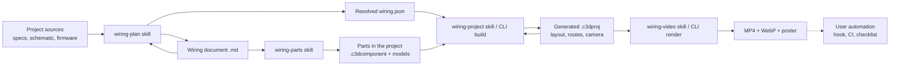

# Automated 3D wiring videos — plan

Status, 2026-11-16: feasibility study and spike done; implementation started (`wiring-plan` skill, part converter
command line). Details in "Status and next steps" below.
Upstream tool: [Circuit Studio 3D](https://github.com/arslansadiq87/circuit-studio), worked on through the fork
[docteurzoidberg/circuit-studio](https://github.com/docteurzoidberg/circuit-studio). Findings: [docs/upstream-study.md](docs/upstream-study.md).

## Goal

Give any electronics project a short 3D video of its wiring, produced from the project's own documentation:

1. A Claude Code skill writes (or helps write) the project's wiring document from whatever sources exist:
   specifications, schematics, firmware configuration, an existing wiring page.
2. A skill finds or builds the 3D parts that Circuit Studio does not ship.
3. A skill generates the Circuit Studio project (layout, wire routes, camera, presentation texts), which the user
   can open and refine in the Circuit Studio editor.
4. A skill and a CLI render the video locally from that project.
5. Each user then decides how to automate it in their own project (git hook, CI, pre-push checklist).

The tooling is generic: it must work on any project and adapt to the tools installed on the user's machine.

## Decisions

| # | Decision |
|---|---|
| D1 | Rendering runs locally in a real Chrome with a GPU (on WSL: the Windows Chrome). Hosted CI rendering is not a goal. |
| D2 | Source of truth is a **structured but free-form Markdown** wiring document, not a strict YAML file. |
| D3 | The Markdown document is **read by the skills, not by a parser** (revised 2026-11-16). A skill resolves it into a committed `wiring.json` ([schema](schema/wiring.schema.json)); the CLI reads only that file, without an LLM, so hooks and CI can render without Claude. The JSON records the document's hash, so the CLI reports when it is stale. Template and JSON format evolve as the next phases need new fields. |
| D4 | 3D parts (STEP, GLB, part definitions) live in the user's project; the user decides whether they may be published. |
| D5 | Distribution is a single npm package with a CLI, in the style of REA: `npx <name> init`, `<name> render`, `<name> mcp`, `npx <name> uninstall`. A Claude Code plugin is evaluated as an alternative. |
| D6 | Upstream changes are made in the fork first and proposed as pull requests later. |
| D7 | Everything written in this repository and upstream (docs, skills, code, PRs, commits) is in English. |
| D8 | The architecture below (three skills, Markdown source, CLI + MCP, generated `.c3dproj`, user-chosen automation) is validated (2026-11-16). |
| D9 | Circuit Studio access: the local clone with the Vite dev server for the spike; target is a pinned build of the fork with an automation API, bundled in the npm package. The hosted site is a fallback only. |
| D10 | Upstream changes to propose: F1 automation API, F2 video settings in the project, F4 model references from `modelId`. Dropped or moved elsewhere: F3, F5, F6, F7, F8, F9, F10 (see [docs/feasibility-results.md](docs/feasibility-results.md)). |
| D11 | Our package includes a **part converter**: STEP to `.c3dcomponent` (simplification, colour rules, contact measurement, light GLB). |
| D12 | STEP engine for the converter: Python + CadQuery first; evaluate WASM when packaging for `npx`. Plans: [docs/tool-changes-plan.md](docs/tool-changes-plan.md) (order: base-path assets, model references, presentation in project, automation API) and [docs/part-converter-plan.md](docs/part-converter-plan.md). |
| D13 | The skills offer to record, in a **`.circuitstudio/` folder at the root of the user's project**, the steps of the kit's integration and the generated files that only Circuit Studio or the kit use afterwards. The user decides whether to commit it, depending on its content. The wiring document itself stays where the user chose (the skill always asks). Content to be defined (open question 6). |
| D14 | `wiring-parts` (2026-11-16): at launch it takes a **snapshot of the Circuit Studio catalog** (from the automation API `listParts()` once upstream has it; until then from Circuit Studio's sources: a local checkout when present, offline, else the author's repository, downloaded only after asking (D15); command `part catalog`, `tools/catalog/`) (built-in parts and their pins) into `.circuitstudio/catalog.json`, compares it with the parts of the validated wiring document and the model files found in the project, lists the missing parts, then proposes how to get each (online search, modelling from the technical drawings available, stand-in). Prepared parts go to **`.circuitstudio/parts/<id>/`** (`part.yaml`, `.c3dcomponent`, preview). Built in this order: the `part inspect` / `part convert` command line from the spike prototype first, then the skill on top; the skill's first version covers model files already in the project and stand-ins, online search and modelling come next. User guide: [docs/user-guide/skills/wiring-parts.md](docs/user-guide/skills/wiring-parts.md). |
| D15 | **No external call without asking** (2026-11-16): every skill asks the user before any network access (fetching the Circuit Studio catalog, an online search for a model or a datasheet, a download), saying what it will fetch and from where, and offers to go on without it. |
| D16 | **Node is the only runtime a user needs** (2026-11-16): `npx`, the MCP server, driving the browser for rendering and reading the Circuit Studio catalog all need Node anyway. The STEP converter is ported from Python (CadQuery) to Node with OpenCascade compiled to WebAssembly: `opencascade.js` 2.0.0-beta.b5ff984, pinned (the only build with the STEP colour/name reader and the glTF writer; `replicad-opencascadejs` lacks both). Trial on the Claudemètre's MRD076A: same solids, faces and names as CadQuery, 61 s, 1.7 GB peak, a 64 MB package instead of a 1.8 GB Python environment ([docs/part-converter-plan.md](docs/part-converter-plan.md)). The Python `tools/c3dparts/` stays as the reference the Node outputs are tested against; it is not shipped. Supersedes the engine part of D12. (On the Python reference: superseded by D19.) |
| D18 | **`wiring-parts` writes its decisions into the document** (2026-11-16): each part's choice goes back into `wiring.md` (the *Part* column: catalog `modelId`, prepared part id or `stand-in W x H x T`; a stand-in's pins; pin names a catalog part cannot answer to; a note), shown to the user and written only with their agreement, so the document stays the single source of truth. **Stand-ins have no file**: they stay declared in the document, as `wiring.json` already allows, and the project builder draws the box. Prepared parts name their pins as the document does (labels, aliases). |
| D19 | **No Python left in the kit's tools** (2026-11-16): the Python part tools (`tools/c3dparts/`) are removed, superseding the part of D16 that kept them as the test reference. Porting them was validated (same outputs on the fixture and the Claudemètre parts), and keeping them meant making every converter change twice. Their outputs stay as the expected values of the tests (`tools/parts/test/fixtures/*.reference.json`), regenerated on purpose only when an output changes by design; the fixture STEP is written by `tools/parts/test/fixture.ts` (same `inspect` and `convert` outputs as the CadQuery one). The spike's Python scripts stay until the `render` command replaces `spike/serve.py`. |
| D17 | **The kit is written in TypeScript** (2026-11-16), like Circuit Studio, so agents and contributors read one language across both projects. Node 22 runs the `.ts` files directly (type stripping, erasable syntax only, imports ending in `.ts`); `npm run typecheck` checks them with `tsc`; the published package will be a built bundle. |
| D20 | **`wiring-project` resolves the document into `wiring.json`** (2026-11-16), as its first step, instead of a second run of `wiring-plan` after the parts: the user goes straight from `wiring-parts` to `wiring-project`, and every build checks that `wiring.json` still matches its document. The skill reads the Markdown (D3) and looks pins up with `part pins` (prepared parts and the catalog snapshot, no `.c3dcomponent` to read); the CLI `wiring` checks the result with ajv against the schema, then parts, pins and the document's hash. Answers to ambiguities go into `wiring.md`, so a new resolution gives the same file. |
| D21 | **`build` plans routes with Circuit Studio's own planner, run in Node** (2026-11-16): the project schema, the built-in part templates and the route planner (`src/model.ts`, `src/autoRouting.ts`) are bundled with esbuild from a local Circuit Studio checkout (the catalog snapshot's, or `--from`) into the kit's `.cache/engine/`, as `part catalog` already does, so `build` needs no browser and checks the routes the app will draw. The same planner is proposed upstream as `planRoutes()` in the automation API; `build` moves to it once upstream has it. Placement: layout hints, else the most connected part at the centre and each other part next to the pins its wires leave from (scored by orthogonal length and parts crossed); flat parts may turn, parts standing up keep the pose `wiring-parts` gave them; parts of blocked wires are moved a few times. Edits made in Circuit Studio win: `.circuitstudio/build.json` records what `build` wrote, so a placement, wire shape or camera that differs is the user's and is kept; the document still decides connections and colours. The review is done by the user in Circuit Studio until the browser driver of `render` can show images. |
| D22 | **The review is done on the project loaded in Circuit Studio, with no preview of its own** (2026-11-16): a preview drawn by the kit could not replace looking at the generated project in Circuit Studio, which the user does anyway, so the kit draws none. What the review lacks is a shorter loop: the page opens the project, reloads it at every build and sends the user's edits back to `.circuitstudio/project.c3dproj`, through the bridge of D23. Until then the user opens and saves the file. |
| D23 | **Circuit Studio connects to the kit; the kit drives no browser** (2026-11-16): the Circuit Studio page opens a WebSocket to the kit on 127.0.0.1 (opt-in URL parameter carrying the address and a token; the kit accepts only that origin and token) and runs the kit's requests from the inside, through its automation API: open the project, read the user's edits, render. The bridge lives in a background process of the kit (`studio`, D25) that the skill starts when the review begins; the user, or the kit through the default browser, only opens the page; the page reconnects by itself; a skill that needs it and finds no page asks the user to open it or offers to. Another project's process takes the next port and names it in the link it opens. Without a user (`render` in CI) the command runs the same bridge for its own time, with a headless Chrome it only launches. Proposed upstream after the API, as a generic remote bridge of the automation API; until both are upstream the page is a build of the fork on this machine. Replaces driving a browser over its debugging port (a profile of its own, fragile from WSL: tried and dropped) and a skill driving the user's browser (dropped: it would need an agent for every render and the site's API anyway). At `init` the user chooses the local build (review and rendering automated) or the manual way: they open and save the project themselves, and neither loading nor rendering can be automated without a local copy of Circuit Studio until upstream has the API and the bridge. |
| D24 | **The kit's user is responsible for the third-party models they use** (2026-11-16): a prepared part, the generated project and the rendered media embed or show models that may come from third-party STEP files (GrabCAD, vendor sites) with their own licences. The kit never refuses such a model nor decides for the user: the skills say which parts come from third-party models and that publishing them is the user's call and responsibility, and let them choose what is committed; the user guide says the same. Re-rendering a public project in CI needs its parts and project committed, so it is the same choice. |
| D25 | **No MCP server** (2026-11-16): the skills hold the instructions and the command line the actions, so MCP tools copying the commands would only duplicate them; the one thing an MCP server would have brought, a process that lives through the review to hold the bridge (D23), is a background process of the command line instead: `studio open` starts it when needed, `studio sync`, `status` and `stop` talk to it over 127.0.0.1 with a control token kept in `.circuitstudio/studio.json`. Nothing to register nor restart, any agent that runs commands can use it, and CI uses the same code. Supersedes the MCP parts of D5, D8 and the first version of D23. An MCP server may come back later as an optional remote access (see Open questions), wrapping the same commands. |
| D26 | **The video first, extras on request** (2026-11-16): `render` makes the MP4 (or WebM when the browser cannot encode H.264) and nothing else by default. A poster image (a still for a README), a light animated WebP (a README on GitHub does not play an MP4 inline) and automation (CI, hook) are offered by `wiring-video` after the render, according to what the user wants the video for; `render` makes them only on explicit options. Once the user validates, `wiring-project` offers to go on to `wiring-video`; on yes the page stays connected for it, on no the kit stops `studio`. |
| D27 | **Each skill keeps its setup in its own file** (2026-11-17): what a skill asked once is kept, so running it again resumes without asking. `wiring-plan` has `wiring.md`, `wiring-parts` the `parts/` folders, `wiring-project` `wiring.json` (only what the document says: parts, connections, placement hints) and `build.json`; `wiring-video` gets `.circuitstudio/video.json`: Circuit Studio's video settings and camera scenes, the outputs besides the video, later the automation. A missing section means not chosen yet: on the first render the user picks Circuit Studio's defaults, sets them in the page (read back by `studio sync`) or answers questions in the chat (`video settings`, checked by the page's `videoSettings()`). `render` passes them to the page, so the same file gives the same video anywhere (CI included) and does not depend on the project file storing them (#6); `build` copies them into the project for the page's dialog. |

## Architecture



### Package

One npm package (name to be chosen):

```bash
npx <name> init           # install the kit (project or global): skills, how to reach Circuit Studio (D23)
npx <name> uninstall      # remove what init installed, keep the project's files
npx <name> check          # where the project stands with the kit, and the next step to take
npx <name> part <command> # wiring-parts: catalog, inspect <model.step>, convert <part.yaml>; pins <part id>...
npx <name> wiring         # wiring-project: check .circuitstudio/wiring.json against its document and the parts
npx <name> build          # wiring-project: generate or update .circuitstudio/project.c3dproj
npx <name> studio <cmd>   # wiring-project: open, sync, status, stop: the project in Circuit Studio for the review (D23)
npx <name> render         # wiring-video: the MP4 -> .circuitstudio/media/; poster and WebP on request (D26)
```

The commands follow the skills, in the order a user meets them. Every command works on the project's
`.circuitstudio/` folder, found from the current folder upwards (as git finds `.git/`), and needs no file name,
except `part inspect` (a STEP model) and `part convert` (a part spec, `.circuitstudio/parts/<id>/part.yaml`).
`check` reads `.circuitstudio/` and reports the steps done, the step in progress and what to do next (missing
parts, a `wiring.json` older than its document, a project not built or not rendered since the last change).

The CLI holds all the logic; the skills call it (no MCP server, D25). A user can automate rendering with the CLI
alone, without Claude.

`init` asks whether to install the kit for the current project only (`.claude/` of the project) or globally (the
user's `~/.claude/`), and does nothing else without that answer. `uninstall` undoes exactly what `init` did: it removes the installed skills and the kit's settings,
and lists what it removed. `init` records what it installs so that `uninstall` touches nothing else. The
project's own files (wiring documents, `wiring.json`, parts, rendered videos) are never removed.

### Skills

| Skill | Role |
|---|---|
| `wiring-plan` | Reads the project's sources (any format) and writes or completes the wiring document from the provided template. Reports inconsistencies, e.g. a GPIO in the docs that differs from the firmware. Asks for the exact terminal when several are equivalent (GND, 3V3, 5V) and can suggest the nearest one. Writes pins as the project's sources name them; Circuit Studio pin identifiers are only needed later, when `wiring-project` resolves the document into `wiring.json` (D20). Interviews a user who starts from nothing. Reviews the document with the user until they validate it. |
| `wiring-parts` | For each part missing from the Circuit Studio catalog (the user's own model first, otherwise created), runs the part converter (D11). Sources, in order: a STEP already in the project, an online search, modelling from technical drawings with the CAD tools found on the machine (Fusion, FreeCAD, CadQuery, Blender…), or a procedural board with headers as a fallback. Offers to simplify a model only when it is really complex (many solids, a heavy mesh, as reported by `part inspect`); otherwise uses it as it is. Restores colours by rules when a STEP has none, places the pin anchors and checks them with a render. |
| `wiring-project` | First resolves the document into `wiring.json` (D20: `part pins`, then the CLI `wiring` checks it), then generates the Circuit Studio project from `wiring.json` and the parts (CLI `build`): placement, wire routes, camera and presentation texts. Reports blocked routes. Reviews the project, loaded in Circuit Studio, with the user until they validate it (D22): they ask for changes in plain language or edit the project in the Circuit Studio editor; a regeneration keeps their manual edits. |
| `wiring-video` | Renders the video from the validated project (CLI `render`), in the Circuit Studio page (still connected when the user accepted the video at the end of `wiring-project`): the MP4 first; then offers, as the user needs them, a poster image, an animated WebP for a README, and their own automation (CI, hook) (D26). |

### Review and rendering process (`studio`)

The Circuit Studio page connects to the kit and runs its requests through the automation API (D23). The kit's end
is a background process of the command line (D25): `studio open` starts it when needed, opens the link in the
user's browser (after the skill asked) and loads the project; `studio sync` writes the user's edits back into the
project; `studio status` and `studio stop`. Rendering comes on the same process with `render`.

## Wiring document format

A Markdown file written by a human or by Claude, readable as documentation. Only two tables are required.

| Required | Free |
|---|---|
| A parts table and a connections table, found by their headers | Title, order and content of every other section: notes, power budget, warnings, schematic |
| Each connection has a source and at least one destination | Column order, extra columns, header names (*From*, *Source*… are recognised as synonyms) |
| Every part named in a connection exists in the parts table | Pin spelling (`GPIO4`, `4 · GPIO4`, `pin 4`), resolved through the part's pin aliases |
| | Several destinations in one cell, e.g. a common ground |

```markdown
## Parts
| Name          | Part               | Note                       |
|---------------|--------------------|----------------------------|
| Terminals     | mrd076a            | ESP32-S3 plugged on top    |
| Session gauge | so-45              | full scale lowered to 3 V  |
| Display       | tm1637-4digit      |                            |
| D1            | diode-1n400x       |                            |

## Connections
| Wire  | From            | To                                      | Note          |
|-------|-----------------|-----------------------------------------|---------------|
| blue  | Terminals GPIO4 | Session gauge +                         | PWM 25 kHz    |
| red   | Terminals 5V0   | D1 anode                                | then strip +5V|
| black | Terminals GND   | Session gauge −, Display GND, Strip GND | common ground |
```

The skill reads the document, not a parser: it accepts any reasonable layout, resolves each pin reference to a
pin identifier of the part, and asks the user instead of guessing when a reference is ambiguous or unknown,
citing the line. It writes the result to `.circuitstudio/wiring.json`, the only input of the CLI.
Example: [examples/claudemetre/wiring.json](examples/claudemetre/wiring.json), resolved from
[wiring.md](examples/claudemetre/wiring.md).

### Generated project and manual edits

3D layout, wire routes and camera are not in the Markdown. They live in a generated `.c3dproj` next to it, which
the user may refine in the Circuit Studio editor. Regenerating after a document change must keep those edits;
parts and wires have stable IDs, so a merge looks feasible (to be confirmed by the spike).

## Rendering

- Circuit Studio already renders the video in the browser (WebCodecs, H.264 MP4). The page connected to the kit
  (D23) renders on the kit's request, through the automation API, and sends the file back.
- With a user: the page they opened (to check: how rendering copes with a hidden tab, which browsers slow down).
  Without one (CI): the command serves the local build and launches a headless Chrome on it, which connects alike.
- Outputs: MP4, an animated WebP or GIF for READMEs, a poster PNG.
- GitHub does not play a committed MP4 inline in a README; the README shows the WebP/GIF and links to the MP4.

## Upstream contributions (fork first, PRs later)

Candidates, detailed in the study: automation API, video settings stored in the project, URL parameters,
compact wiring import, import adapters, Linux test path; then the page's bridge to the kit (D23), after the API.
Each starts as an issue upstream.

## Status and next steps

Last update: 2026-11-16. Resume from here.

### Done

- **Feasibility study and spike** (phases 1 and 2): a Markdown wiring document plus parts converted from STEP
  files gave a correct 1080p wiring video of the reference project, rendered by Circuit Studio. Results, tests A
  to G and findings: [docs/feasibility-results.md](docs/feasibility-results.md).
- **Circuit Studio changes, all four written** ([docs/upstream-contributions.md](docs/upstream-contributions.md)):

  | Change | State |
  |---|---|
  | Base-path assets | Fixed upstream by the maintainer in `1713780` (issue #1, pull request #2 closed) |
  | Model references | Fixed upstream in `1713780` (issue #3, pull request #4 closed); follow-up pull request #7 |
  | Presentation in project | Proposed: issue #5, pull request #6 |
  | Automation API | Fork branch `feat/automation-api`, checked end to end, published once #6 is settled |

- **Reference example**: [examples/claudemetre/wiring.md](examples/claudemetre/wiring.md), the typical document
  `wiring-plan` should write and the next skills consume (parts with model paths, connections, layout hints,
  checks). The generated `claudemetre.c3dproj` stays local (it embeds models from third-party STEPs).
- **Findings that shape the next phases**: wires must use `routeMode: "clean"`; the clean router can block a
  connection depending on part placement, so the project builder must check `routingBlocked` and move parts;
  heavy meshes drive render time, so `wiring-parts` simplifies models; bug 3 is intended behaviour.

### Next steps

1. **Follow upstream** at the start of each session: state of #1 to #7, review comments, rebase the fork
   branches if `main` moved; update the README State column and docs/upstream-contributions.md.
2. **Upstream changes**: the maintainer fixed #1 and #3 himself in `1713780` (#2 and #4 closed); Presentation in
   project proposed on 2026-11-16 as issue #5 and pull request #6 (the maintainer merges it or implements it his
   own way); the built-in model fallback (the upstream fixture still opened with unavailable models) proposed as
   pull request #7 with a comment on #3. Next: the Automation API, ready and checked end to end
   ([texts](docs/upstream-drafts/automation-api.md)), published once #6 is settled, rebased on what lands.
3. **Phase 3, document format** — done: (a) `wiring-plan` writes `wiring.md` from the project's sources — first
   version in [skills/wiring-plan/](skills/wiring-plan/) with its template, tested by a fresh agent on a local
   copy of the Claudemètre, being refined; (b) resolution into `wiring.json`, the first step of `wiring-project`
   (D20) — [skills/wiring-project/resolve.md](skills/wiring-project/resolve.md), the
   [schema](schema/wiring.schema.json) and the showcase example [examples/claudemetre/](examples/claudemetre/);
   tested on 2026-11-16 by a fresh agent on the Claudemètre copy left by the `wiring-parts` test: 8 parts and 16
   wires resolved without a question, identical to the example (whose display pins were then renamed `P1` to `P4`,
   the identifiers `wiring-parts` gives them); (c) the CLI `part pins` and `wiring` (schema with ajv, parts, pins
   with a hint when a label is used, document hash; `--wires` lists every wire for review).
4. **Phase 4, `wiring-parts`** (D14): first the `part inspect` and `part convert` command line per
   [docs/part-converter-plan.md](docs/part-converter-plan.md) — done, first in Python + CadQuery (`tools/c3dparts/`,
   removed since, D19; on the Claudemètre's MRD076A it matches the spike within 0.007 mm and flags complex models for
   simplification), then ported to Node in `tools/parts/` (D16), in TypeScript (D17), which gives the same outputs; the catalog
   snapshot — done in `tools/catalog/`; the `part` command (`catalog`, `inspect`, `convert`, entry point
   `tools/cli.ts`) — done; the skill (catalog parts, model files in the project, stand-ins; D18) — first version
   in [skills/wiring-parts/](skills/wiring-parts/), tested by a fresh agent on the Claudemètre copy on 2026-11-16
   (5 parts prepared and validated, 2 stand-ins kept) and corrected after it; the converter fixed so its parts
   load in Circuit Studio (`modelAssetId`, dimensions measured on the GLB). Tool improvements found by the test,
   for later: `inspect` does not find the tips of right-angle header pins; the preview draws hidden geometry
   (studs seen through a body) and overlaps pin labels in the front view; `mergeByColour` drops the reuse of
   identical meshes and can make the file larger; a check of each part in Circuit Studio itself, through the
   automation API's `openProject` and `renderImage` on a small project holding the part (projects embed their
   parts' models, so no import call is needed). Then online search and modelling.
5. **Phase 5, `wiring-project`** — first version done on 2026-11-16 (D21): the CLI `build` (`wiring.json` and
   parts to `.c3dproj`, clean routing, layout hints, automatic placement that moves the parts of blocked wires,
   edits made in Circuit Studio kept through `build.json`, `--move`, `--reset`, `--dry-run`), 12 tests; on the Claudemètre (6 prepared parts, 2
   stand-ins, 16 wires) the automatic layout routes every wire in 1.5 s and the project opens in Circuit Studio
   (fork build) with its models, no validation error and no blocked wire; then the skill's build and review
   steps, tested by a fresh agent on the Claudemètre copy (layout from the document, two moves asked in words,
   a blocked wire solved with the user, project validated; it found that an edit was kept by one build only,
   fixed, and asked for `--move` and `--dry-run`, added). Found on the way and fixed: the converter placed every instance of a repeated STEP shape on the first
   one (the MRD076A board measured 110.7 x 140.6 mm instead of 73.6 x 84.7 mm), with a regression test. Routing a
   whole project costs seconds (11 s for the 28 wires of the upstream fixture), so placement is scored without
   routing and the planner runs once per attempt. For later: the live link of the review (D23, phase 6),
   presentation texts, stand-ins drawn with visible contacts, and a look at why turning the
   LED strip stand-in (pins exiting upwards) blocked a wire between two other parts in the test.
6. **Phase 6, bridge and rendering** (D23):
   1. Fork: the page's connection to the kit on a branch of its own on top of `feat/automation-api` (opt-in URL
      parameter with address and token, reconnection, transfers in pieces), with tests; a pull request after the
      API's.
   2. Kit: the bridge and the review commands (`studio open`, `sync`, `status`, `stop`, in a background process,
      D25) — written on 2026-11-16 (`tools/studio/`, `tools/bridge/`, 8 tests; first as an MCP server, dropped the
      same day) and checked end to end with the fork
      branch `feat/kit-bridge` (written, 6 tests): the Claudemètre project opened in the page, an image rendered in
      0.7 s; the review of `wiring-project` on it, tested by a fresh agent with the owner on 2026-11-16 (project
      opened in the owner's browser, an edit made in the editor read back and kept by build, page reloaded,
      validated); the page's header shows a red badge with the driving tool, its address and **Disconnect**.
      After validation the skill offers the video while the page is connected, keeping it connected. Next:
      `init` offers the local build or the manual way.
   3. `render` on the same bridge: the MP4 first, poster and WebP on request (D26) — `render` and `--poster`
      written on 2026-11-17 and checked on the Claudemètre in the owner's browser (1920 × 1080, 30 fps, 57 s,
      14.5 MB, rendered in 144 s); the page shows API renders in its own progress panel. Next: the WebP, the
      `wiring-video` skill, then headless Chrome for CI after measuring a render on a GitHub runner.
7. Then phases 7 and 8 below.

## Phases

1. **Feasibility study** — done 2026-11-16: upstream study, reference project case, format and architecture
   decisions.
2. **Spike** — done 2026-11-16, see [docs/feasibility-results.md](docs/feasibility-results.md): hosted site
   unusable, local clone works, an automation API (F1) and video settings in the project (F2) are needed upstream.
3. **Document format** — done 2026-11-16: Markdown template read by the skill, resolved `wiring.json` and its
   schema, CLI `part pins` and `wiring`; tested on the reference project's wiring.
4. **Parts** — part definition from a STEP or a procedural board; pin aliases; preview render.
5. **Project** — first version done 2026-11-16: CLI `build` (`wiring.json` to `.c3dproj`) with automatic layout and
   routing, merge with manual edits; the `wiring-project` skill.
6. **Bridge and rendering** — the Circuit Studio page connects to the kit (D23, D25): live review of the
   project, then `render` with MP4, WebP and poster outputs.
7. **Skills and packaging** — `wiring-video` (`wiring-plan` is done in phase 3, `wiring-parts` in phase 4,
   `wiring-project` in phase 5); packaging, `init` (with the choice of D23) and
   `uninstall`.
8. **Reference project end to end**, then the remaining upstream issues and pull requests.

## Open questions

Ideas kept for later (not planned until needed):

- **Optional model module** (2026-11-16): if the WebAssembly converter proves heavy, ship model conversion, creation and
  simplification as an optional part of the kit that `init` offers only to users with models to convert; users with
  catalog parts and stand-ins keep a light kit. Until then the skills are designed and tested as if it were always there.
- **MCP server for remote agents** (2026-11-16, D25): an agent running elsewhere (in a container, e.g. Hermes or
  OpenClaw) cannot run the kit's commands nor read the project's files, but it can reach an MCP server over the
  network. An optional MCP server over HTTP, running on the user's machine next to the project and the browser,
  would expose the same commands (`studio` included) as tools. Only when such a user needs it.
- **`circuitstudio-opencascade`**: a fork of `opencascade.js`, maintained by us, only if we ever need to add or change
  something in the OpenCascade build (a missing class, a fix, a newer OCCT).

1. Package name, and npm package versus Claude Code plugin (or both).
2. ~~Where the wiring document lives~~ — `wiring-plan` always asks the user; tool-only files go to
   `.circuitstudio/` (D13). Where the prepared parts live is part of question 6.
3. ~~How the CLI gets Circuit Studio~~ — answered by D9.
4. Quality of automatic 3D layout on a real circuit; how much manual placement is acceptable.
5. Parts stacked on others (a board plugged onto a terminal adapter) and inline parts (a diode in series).
6. Content of `.circuitstudio/` (D13). Decided: `catalog.json` and `parts/<id>/` (D14), `wiring.json`
   (only the kit reads it), the generated project `project.c3dproj` (written by `wiring-project`) and the
   rendered `media/` (2026-11-16: every command except `part` finds its files there). Candidates: an integration log (steps done, choices made, what `init` installed, which
   `uninstall` reads), preview frames. Committed or not: `wiring.json` must be committed for rendering without
   Claude; parts and project are the user's choice and responsibility when they hold third-party models (D24).

## Risks

| Risk | Mitigation |
|---|---|
| Upstream is two days old and changes fast | Pin a commit; keep the adapter thin; contribute a stable API |
| Many parts missing from the catalog | `wiring-parts` skill; procedural fallback; parts reusable across projects |
| Automatic layout unreadable on dense circuits | Keep manual edits in the generated project; review it in Circuit Studio before rendering |
| Driving a browser (Windows Chrome from WSL especially) is fragile | Avoided by D23: the page connects to the kit; only CI launches a headless Chrome |
| Upstream refuses the bridge or the API | The local build of the fork stays the automated way (D23); the manual way always works |
| A hidden tab slows rendering down | To check in phase 6; else ask the user to keep the page visible while it renders |
