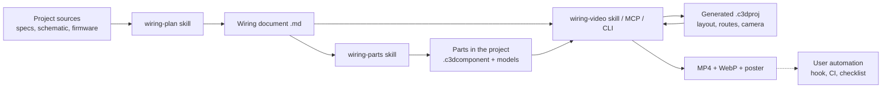

# Automated 3D wiring videos — plan

Status: feasibility study, 2026-11-16. Nothing is implemented yet.
Upstream tool: [Circuit Studio 3D](https://github.com/arslansadiq87/circuit-studio), worked on through the fork
[docteurzoidberg/circuit-studio](https://github.com/docteurzoidberg/circuit-studio). Findings: [docs/upstream-study.md](docs/upstream-study.md).

## Goal

Give any electronics project a short 3D video of its wiring, produced from the project's own documentation:

1. A Claude Code skill writes (or helps write) the project's wiring document from whatever sources exist:
   specifications, schematics, firmware configuration, an existing wiring page.
2. A skill finds or builds the 3D parts that Circuit Studio does not ship.
3. A skill, an MCP server and a CLI render the video locally.
4. Each user then decides how to automate it in their own project (git hook, CI, pre-push checklist).

The tooling is generic: it must work on any project and adapt to the tools installed on the user's machine.

## Decisions

| # | Decision |
|---|---|
| D1 | Rendering runs locally in a real Chrome with a GPU (on WSL: the Windows Chrome). Hosted CI rendering is not a goal. |
| D2 | Source of truth is a **structured but free-form Markdown** wiring document, not a strict YAML file. |
| D3 | The document is parsed **deterministically** by the CLI, without an LLM, so hooks and CI can render without Claude. |
| D4 | 3D parts (STEP, GLB, part definitions) live in the user's project; the user decides whether they may be published. |
| D5 | Distribution is a single npm package with a CLI, in the style of REA: `npx <name> init`, `<name> render`, `<name> mcp`. A Claude Code plugin is evaluated as an alternative. |
| D6 | Upstream changes are made in the fork first and proposed as pull requests later. |
| D7 | Everything written in this repository and upstream (docs, skills, code, PRs, commits) is in English. |
| D8 | The architecture below (three skills, Markdown source, CLI + MCP, generated `.c3dproj`, user-chosen automation) is validated (2026-11-16). |
| D10 | Upstream changes to propose: F1 automation API, F2 video settings in the project, F4 model references from `modelId`. Dropped or moved elsewhere: F3, F5, F6, F7, F8, F9, F10 (see [docs/feasibility-results.md](docs/feasibility-results.md)). |
| D11 | Our package includes a **part converter**: STEP to `.c3dcomponent` (simplification, colour rules, contact measurement, light GLB). |
| D12 | STEP engine for the converter: Python + CadQuery first; evaluate WASM when packaging for `npx`. Plans: [docs/tool-changes-plan.md](docs/tool-changes-plan.md) (PR order: hosting bugs, F4, F2, F1) and [docs/part-converter-plan.md](docs/part-converter-plan.md). |
| D9 | Circuit Studio access: the local clone with the Vite dev server for the spike; target is a pinned build of the fork with an automation API, bundled in the npm package. The hosted site is a fallback only. |

## Architecture



### Package

One npm package (name to be chosen):

```bash
npx <name> init              # install the skills, register the MCP server
<name> check docs/wiring.md  # parse and validate the wiring document
<name> render docs/wiring.md --out docs/media/
<name> mcp                   # MCP server entry point
```

The CLI holds all the logic; the MCP server and the skills call it. A user can automate rendering with the CLI
alone, without Claude.

### Skills

| Skill | Role |
|---|---|
| `wiring-plan` | Reads the project's sources (any format) and writes or completes the wiring document from the provided template. Reports inconsistencies, e.g. a GPIO in the docs that differs from the firmware. Asks for the exact terminal when several are equivalent (GND, 3V3, 5V) and can suggest the nearest one. Queries Circuit Studio for each model's pins and maps them into the document, or writes the document with those pin names. Can also guide a user who starts from nothing. |
| `wiring-parts` | For each part missing from the Circuit Studio catalog (the user's own model first, otherwise created), runs the part converter (D11). Sources, in order: a STEP already in the project, an online search, modelling from technical drawings with the CAD tools found on the machine (Fusion, FreeCAD, CadQuery, Blender…), or a procedural board with headers as a fallback. Warns early that simplified models render much faster (simplification stays on the user's side). Restores colours by rules when a STEP has none, places the pin anchors and checks them with a render. |
| `wiring-video` | Builds the Circuit Studio project, shows preview frames, renders the video, and helps the user set up their own automation. |

### MCP server

Thin wrapper over the CLI: `check_document`, `list_parts`, `build_project`, `render_preview`, `render_video`.

## Wiring document format

A Markdown file written by a human or by Claude, readable as documentation. Only two tables are required.

| Required | Free |
|---|---|
| A parts table and a connections table, found by their headers | Title, order and content of every other section: notes, power budget, warnings, schematic |
| Each connection has a source and at least one destination | Column order, extra columns, header names (*From*, *Source*… are recognised as synonyms) |
| Every part named in a connection exists in the parts table | Pin spelling (`GPIO4`, `4 · GPIO4`, `pin 4`), resolved through the part's pin aliases |
| | Several destinations in one cell, e.g. a common ground |

```markdown
## Parts
| Name          | Part               | Note                       |
|---------------|--------------------|----------------------------|
| Terminals     | mrd076a            | ESP32-S3 plugged on top    |
| Session gauge | so-45              | full scale lowered to 3 V  |
| Display       | tm1637-4digit      |                            |
| D1            | diode-1n400x       |                            |

## Connections
| Wire  | From            | To                                      | Note          |
|-------|-----------------|-----------------------------------------|---------------|
| blue  | Terminals GPIO4 | Session gauge +                         | PWM 25 kHz    |
| red   | Terminals 5V0   | D1 anode                                | then strip +5V|
| black | Terminals GND   | Session gauge −, Display GND, Strip GND | common ground |
```

Parsing is tolerant but deterministic: the same document always gives the same result, and a line the parser
cannot resolve is reported with its line number instead of being guessed.

### Generated project and manual edits

3D layout, wire routes and camera are not in the Markdown. They live in a generated `.c3dproj` next to it, which
the user may refine in the Circuit Studio editor. Regenerating after a document change must keep those edits;
parts and wires have stable IDs, so a merge looks feasible (to be confirmed by the spike).

## Rendering

- Circuit Studio already renders the video in the browser (WebCodecs, H.264 MP4). The CLI serves the app,
  drives a local Chrome, loads the project and calls the existing export.
- Supported setups: Chrome on Linux or macOS, Windows Chrome driven from WSL.
- Outputs: MP4, an animated WebP or GIF for READMEs, a poster PNG.
- GitHub does not play a committed MP4 inline in a README; the README shows the WebP/GIF and links to the MP4.

## Upstream contributions (fork first, PRs later)

Candidates, detailed in the study: automation API, video settings stored in the project, URL parameters,
compact wiring import, import adapters, Linux test path. Each starts as an issue upstream.

## Phases

1. **Feasibility study** (current) — upstream study, reference project case, format and architecture decisions.
2. **Spike** — done 2026-11-16, see [docs/feasibility-results.md](docs/feasibility-results.md): hosted site
   unusable, local clone works, an automation API (F1) and video settings in the project (F2) are needed upstream.
3. **Document format** — template, parser, validation messages; tested on the reference project's wiring.
4. **Parts** — part definition from a STEP or a procedural board; pin aliases; preview render.
5. **Project builder** — Markdown to `.c3dproj` with automatic layout and routing; merge with manual edits.
6. **Rendering CLI** — `render` with MP4, WebP and poster outputs.
7. **Skills and MCP server** — `wiring-plan`, `wiring-parts`, `wiring-video`; packaging and `init`.
8. **Reference project end to end**, then upstream issues and pull requests.

## Open questions

1. Package name, and npm package versus Claude Code plugin (or both).
2. Where the template and the parts live in a user project (`docs/wiring.md`, `wiring/parts/`?).
3. ~~How the CLI gets Circuit Studio~~ — answered by D9.
4. Quality of automatic 3D layout on a real circuit; how much manual placement is acceptable.
5. Parts stacked on others (a board plugged onto a terminal adapter) and inline parts (a diode in series).

## Risks

| Risk | Mitigation |
|---|---|
| Upstream is two days old and changes fast | Pin a commit; keep the adapter thin; contribute a stable API |
| Many parts missing from the catalog | `wiring-parts` skill; procedural fallback; parts reusable across projects |
| Automatic layout unreadable on dense circuits | Keep manual edits in the generated project; preview before rendering |
| Driving Windows Chrome from WSL is fragile | Validate in the spike; support native Chrome on Linux/macOS |
