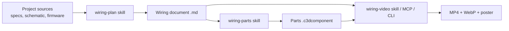

# circuit-studio-agent-kit

Agent skills, an MCP server and a CLI that turn an electronics project's wiring documentation into a 3D wiring
video, using [Circuit Studio 3D](https://github.com/arslansadiq87/circuit-studio) as the rendering engine.

> Status: **feasibility study done, implementation not started.** This repository holds the plan, the study of
> Circuit Studio, the test scripts, and the changes we would like to propose upstream.

## The idea

A maker documents how a project is wired. An agent (Claude Code skills or any MCP client) reads that
documentation, prepares the missing 3D parts, and renders a short video showing every wire being connected,
ready to embed in the project's README or docs. The user decides how to automate it in their own workflow
(git hook, CI, pre-push checklist).

- **Wiring document**: plain Markdown with two required tables (parts, connections), parsed deterministically,
  so renders can run without an LLM.
- **Parts**: a converter turns STEP models into Circuit Studio parts (simplification, colours, measured
  contacts).
- **Rendering**: Circuit Studio's own Auto Video (automatic camera, H.264 MP4 in the browser), driven locally in
  a real Chrome with a GPU.

## What we would like to propose to Circuit Studio

Small, focused pull requests, each discussed in an issue first. Details in
[docs/tool-changes-plan.md](docs/tool-changes-plan.md).

| PR | Change |
|---|---|
| 0 | Asset URLs that respect the Vite base path (bundled models currently 404 on GitHub Pages) |
| 1 | Built-in model references resolved from `modelId` when a project does not carry them |
| 2 | Optional presentation block in the project: video settings, shot overrides, saved camera scenes |
| 3 | A documented automation API (`window.circuitStudio`) available in production builds |

Bugs met during the study: [docs/upstream-bugs.md](docs/upstream-bugs.md).

## Reference project

The study uses the wiring of [Claudemètre](https://github.com/docteurzoidberg/claudemetre), an ESP32-S3 desk
gauge (ESPHome) built on an MRD076A screw-terminal adapter, with two SO-45 panel voltmeters, a TM1637 display, a
WS2812B strip and a 12 V input through an LP-16 socket, a fuse and a Mini360 step-down. A study copy of its
wiring, written in the proposed Markdown format, is in
[spike/reference-project/wiring.md](spike/reference-project/wiring.md).

## Documents

| Document | Content |
|---|---|
| [PLAN.md](PLAN.md) | Goal, decisions, architecture, phases, open questions |
| [docs/upstream-study.md](docs/upstream-study.md) | How Circuit Studio works, access modes, gaps |
| [docs/feasibility-results.md](docs/feasibility-results.md) | Test results, findings, feature decisions |
| [docs/tool-changes-plan.md](docs/tool-changes-plan.md) | Planned upstream pull requests |
| [docs/part-converter-plan.md](docs/part-converter-plan.md) | STEP to `.c3dcomponent` converter |
| [docs/upstream-bugs.md](docs/upstream-bugs.md) | Bugs found in Circuit Studio |

## Spike scripts

`spike/` holds the feasibility test scripts (not the final tooling): a Markdown wiring parser and project
builder run in the Circuit Studio page, STEP inspection, part preparation and simplification with CadQuery,
and a small CORS file server. They expect a local clone of Circuit Studio running on the Vite dev server.

## License

[MIT](LICENSE). Circuit Studio 3D is a separate project by its own authors, also under the MIT license.
