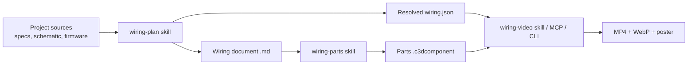

# circuit-studio-agent-kit

Agent skills, an MCP server and a CLI that turn an electronics project's wiring documentation into a 3D wiring
video, using [Circuit Studio 3D](https://github.com/arslansadiq87/circuit-studio) as the rendering engine.

> Status: **feasibility study done, implementation started.** The first skill, `wiring-plan`, works (first
> version); the others are in progress or planned (see [Skills](#skills)). This repository also holds the plan,
> the study of Circuit Studio, the test scripts, and the changes we would like to propose upstream.

## Why

Wiring is the part of a hardware project that is hardest to document well. It usually ends up as a table of
"GPIO4 → gauge +" lines, a schematic, or a few photos: correct, but hard to follow for someone who has to
reproduce the build, and quickly out of date when the wiring changes.

[Circuit Studio 3D](https://github.com/arslansadiq87/circuit-studio) solves the visual part: it places real 3D
models of the parts, routes the wires and generates a video that connects them one by one, with an automatic
camera. What is missing is the path from a project's existing documentation to that video, without rebuilding
the scene by hand in the editor each time the wiring changes.

This kit adds that path, for any electronics project (ESPHome, Arduino, MicroPython, KiCad or no schematic at
all):

- **AI agents do the tedious part**: read the project's specs, schematic or firmware, write a clean wiring
  document, find or convert the 3D models of the parts, map each wire to the right pin.
- **Rendering stays deterministic**: a skill resolves the free-form wiring document into a `wiring.json`;
  once that file and the parts are committed, a plain command renders the video, without an LLM, so it can run
  in a git hook or a CI job.
- **The project owner stays in control**: documents, 3D models and videos live in their own repository; they
  decide what is published and how rendering is automated.

## How it will work



1. **Describe the wiring.** The `wiring-plan` skill reads the project (any format), or interviews the owner
   when there is nothing to read, writes or completes a Markdown wiring document from a template, and reviews
   it with the owner until they validate it. It reports inconsistencies, for example a GPIO in the docs that
   differs from the firmware. Once the parts are ready (step 2), it resolves the document into a `wiring.json`
   (parts, pin identifiers, wire order, layout hints), the only input of the CLI, asking for exact pin names
   using the pins Circuit Studio knows for each part; see [examples/claudemetre/](examples/claudemetre/).

   ```markdown
   ## Parts
   | Name          | Part              | Note                  |
   |---------------|-------------------|-----------------------|
   | Board         | mrd076a-esp32-s3  | screw-terminal adapter |
   | Session gauge | so-45             |                       |

   ## Connections
   | Wire | From         | To              | Note |
   |------|--------------|-----------------|------|
   | blue | Board GPIO4  | Session gauge + | PWM  |
   ```

2. **Prepare the parts.** For each part missing from the Circuit Studio catalog, the `wiring-parts` skill uses
   the project's own STEP model, or helps find or create one, then converts it into a Circuit Studio part:
   colours, measured pin positions, a mesh simplified only when the model is really complex, and a preview to
   check the pins.

3. **Render.** The `wiring-video` skill (or the CLI, or the MCP server) builds the Circuit Studio project, shows
   preview frames, and renders an MP4 plus a WebP and a poster image for the README. Rendering runs locally in
   Chrome with a GPU.

4. **Automate, if wanted.** The CLI works without Claude, so the owner can re-render on push, in a hook or in CI.

Planned commands (one npm package, name still to be chosen):

```bash
npx <name> init                                   # install the skills (project or global), register the MCP server
<name> check docs/wiring.json                     # validate the resolved wiring
<name> part inspect board.step                   # what the model holds: tree, colours, contacts
<name> part convert board.yaml                    # STEP model to Circuit Studio part, from its spec
<name> render docs/wiring.json --out docs/media/  # MP4 + WebP + poster
<name> mcp                                        # MCP server for any agent
npx <name> uninstall                              # remove what init installed, keep the project's files
```

## Skills

The skills are used in this order; each starts from what the previous one produced.

| Skill | What it does | State |
|---|---|---|
| `wiring-plan` | Writes the wiring document from the project's sources, or by interviewing the owner, and reviews it with them until they validate it | **Implemented** (first version, being refined): [user guide](docs/user-guide/skills/wiring-plan.md), [skills/wiring-plan/](skills/wiring-plan/) |
| `wiring-parts` | Gives every part of the document a 3D model Circuit Studio can show, with its pins at the right places | **In progress**: design and [user guide draft](docs/user-guide/skills/wiring-parts.md); the `part inspect` and `part convert` commands are written, the skill comes next |
| Resolution into `wiring.json` | Part of `wiring-plan`, run after the parts: resolves the document into the file the CLI renders from | **Planned**: the [schema](schema/wiring.schema.json) and an [example](examples/claudemetre/wiring.json) exist; the instructions are a [draft](skills/wiring-plan/resolve.md) |
| `wiring-video` | Builds the Circuit Studio project, shows preview frames, renders the video, and helps the owner set up their own automation | **Planned** |

The command line and the MCP server hold the logic the skills call (commands above): `part inspect` and
`part convert` are written (Python prototype in `tools/c3dparts/`); `check`, `render`, `init`, `uninstall` and the MCP server (`mcp`) are planned.

## What the feasibility study showed

Tested on a real project, the [Claudemètre](https://github.com/docteurzoidberg/claudemetre) desk gauge
(details in [docs/feasibility-results.md](docs/feasibility-results.md)):

- A Markdown wiring document with 9 parts and 17 wires, parsed without an LLM, plus parts converted from the
  project's STEP models (terminal adapter with 44 measured screw contacts, panel voltmeters, display, power
  socket, fuse holder), gave a correct 59-second 1080p wiring video, rendered by Circuit Studio.
- The public hosted site cannot be driven yet (bundled models fail to load); a local clone works.
- Mesh weight drives render time: simplified models cut it by 45 % (363 s to 202 s for the 59 s video).
- Durable automation needs a few small changes in Circuit Studio, proposed upstream below.

## What we would like to propose to Circuit Studio

Small, focused pull requests, each discussed in an issue first, in this order. Details in
[docs/tool-changes-plan.md](docs/tool-changes-plan.md). Numbers like #2 are Circuit Studio's own issue and pull
request numbers on GitHub.

| Change | What it does | State |
|---|---|---|
| **Base-path assets** | Asset URLs that respect the Vite base path (bundled models currently 404 on GitHub Pages) | **Open**: issue [#1](https://github.com/arslansadiq87/circuit-studio/issues/1), pull request [#2](https://github.com/arslansadiq87/circuit-studio/pull/2) |
| **Model references** | Built-in model references resolved from `modelId` when a project does not carry them | **Open**: issue [#3](https://github.com/arslansadiq87/circuit-studio/issues/3), pull request [#4](https://github.com/arslansadiq87/circuit-studio/pull/4) |
| **Presentation in project** | Optional presentation block in the project: video settings, shot overrides, saved camera scenes | **Not proposed yet**: implemented and tested, code on the [fork branch](https://github.com/docteurzoidberg/circuit-studio/tree/feat/presentation-in-project); planned texts in [docs/upstream-drafts/presentation.md](docs/upstream-drafts/presentation.md) |
| **Automation API** | A documented automation API (`window.circuitStudio`) available in production builds | **Not proposed yet**: implemented and tested, code on the [fork branch](https://github.com/docteurzoidberg/circuit-studio/tree/feat/automation-api) (built on the two changes above) |

States are updated as the work moves; the full history is in
[docs/upstream-contributions.md](docs/upstream-contributions.md).

Bugs met during the study: [docs/upstream-bugs.md](docs/upstream-bugs.md). Status of what has been proposed:
[docs/upstream-contributions.md](docs/upstream-contributions.md).

## Reference project

The study uses the wiring of [Claudemètre](https://github.com/docteurzoidberg/claudemetre), an ESP32-S3 desk
gauge (ESPHome) built on an MRD076A screw-terminal adapter, with two SO-45 panel voltmeters, a TM1637 display, a
WS2812B strip and a 12 V input through an LP-16 socket, a fuse and a Mini360 step-down. A study copy of its
wiring, as the `wiring-plan` skill writes it and describing the finished build, is the showcase example
[examples/claudemetre/wiring.md](examples/claudemetre/wiring.md), resolved into
[examples/claudemetre/wiring.json](examples/claudemetre/wiring.json). The spike's earlier study copy is in
[spike/reference-project/wiring.md](spike/reference-project/wiring.md).

## Documents

| Document | Content |
|---|---|
| [PLAN.md](PLAN.md) | Goal, decisions, architecture, phases, open questions |
| [docs/user-guide/skills/](docs/user-guide/skills/) | User guides of the skills (`wiring-plan`, `wiring-parts` draft) |
| [docs/upstream-study.md](docs/upstream-study.md) | How Circuit Studio works, access modes, gaps |
| [docs/feasibility-results.md](docs/feasibility-results.md) | Test results, findings, feature decisions |
| [docs/tool-changes-plan.md](docs/tool-changes-plan.md) | Planned upstream pull requests |
| [docs/part-converter-plan.md](docs/part-converter-plan.md) | STEP to `.c3dcomponent` converter |
| [docs/upstream-bugs.md](docs/upstream-bugs.md) | Bugs found in Circuit Studio |
| [docs/upstream-contributions.md](docs/upstream-contributions.md) | Upstream issues and pull requests, and their status |

## Spike scripts

`spike/` holds the feasibility test scripts (not the final tooling): a Markdown wiring parser and project
builder run in the Circuit Studio page, STEP inspection, part preparation and simplification with CadQuery,
and a small CORS file server. They expect a local clone of Circuit Studio running on the Vite dev server.

## Credits

This kit exists because of [Circuit Studio 3D](https://github.com/arslansadiq87/circuit-studio), created by
**Arslan Sadiq** ([@arslansadiq87](https://github.com/arslansadiq87), [TechPanda Labs](https://techpandalabs.com/)):
a free, open-source 3D circuit design and visualization tool for makers, students and electronics enthusiasts,
released under the MIT license. Every 3D view and wiring video produced with this kit is rendered by Circuit
Studio; its editor, part catalog, CAD calibration and Auto Video generator do the actual work. Thank you!

## License

[MIT](LICENSE). Circuit Studio 3D is a separate project by its own authors, also under the MIT license.
