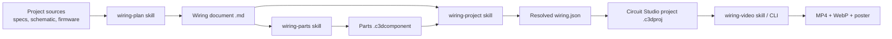
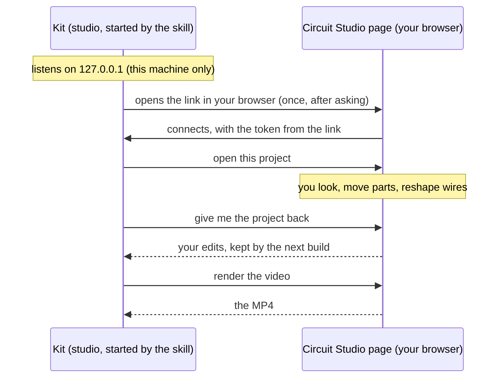

# circuit-studio-agent-kit

Agent skills and a CLI that turn an electronics project's wiring documentation into a 3D wiring
video, using [Circuit Studio 3D](https://github.com/arslansadiq87/circuit-studio) (from Tech Panda) as the rendering engine.

> Status: **feasibility study done, implementation started.** The first two skills, `wiring-plan` and
> `wiring-parts`, work (first versions); the others are planned (see [Skills](#skills)). This repository also holds the plan,
> the study of Circuit Studio, the test scripts, and the changes we would like to propose upstream.

## Why

Wiring is the part of a hardware project that is hardest to document well. It usually ends up as a table of
"GPIO4 → gauge +" lines, a schematic, or a few photos: correct, but hard to follow for someone who has to
reproduce the build, and quickly out of date when the wiring changes.

[Circuit Studio 3D](https://github.com/arslansadiq87/circuit-studio) solves the visual part: it places real 3D
models of the parts, routes the wires and generates a video that connects them one by one, with an automatic
camera. What is missing is the path from a project's existing documentation to that video, without rebuilding
the scene by hand in the editor each time the wiring changes.

This kit adds that path, for any electronics project (ESPHome, Arduino, MicroPython, KiCad or no schematic at
all):

- **AI agents do the tedious part**: read the project's specs, schematic or firmware, write a clean wiring
  document, find/convert/build the 3D models of the parts, map each wire to the right pin.
- **Rendering stays deterministic**: a skill resolves the free-form wiring document into a `wiring.json`;
  once that file and the parts are committed, a plain command renders the video, without an LLM, so it can run
  in a git hook or a CI job.
- **The project owner stays in control**: documents, 3D models and videos live in their own repository; they
  decide what is published and how rendering is automated.

## How it will work



1. **Describe the wiring.** The `wiring-plan` skill reads the project (any format), or interviews the owner
   when there is nothing to read, writes or completes a Markdown wiring document from a template, and reviews
   it with the owner until they validate it. It reports inconsistencies, for example a GPIO in the docs that
   differs from the firmware; see [examples/claudemetre/](examples/claudemetre/).

   ```markdown
   ## Parts
   | Name          | Part              | Note                  |
   |---------------|-------------------|-----------------------|
   | Board         | mrd076a-esp32-s3  | screw-terminal adapter |
   | Session gauge | so-45             |                       |

   ## Connections
   | Wire | From         | To              | Note |
   |------|--------------|-----------------|------|
   | blue | Board GPIO4  | Session gauge + | PWM  |
   ```

2. **Prepare the parts.** For each part missing from the Circuit Studio catalog, the `wiring-parts` skill uses
   the project's own STEP model (finding or modelling one comes later) or a stand-in box, and converts the model
   into a Circuit Studio part:
   colours, measured pin positions, a mesh simplified only when the model is really complex, and a preview to
   check the pins.

3. **Build the project.** The `wiring-project` skill first resolves the document into a `wiring.json` (parts,
   pin identifiers, wire order, layout hints), the only input of the CLI, asking the owner when a pin name is
   ambiguous; then it generates the Circuit Studio project from `wiring.json` and the parts: placement, wire routes, camera and presentation texts. It reviews the
   project, loaded in Circuit Studio, with the owner until they validate it; the owner asks for changes in words or
   moves things by hand in the editor, and a later regeneration keeps those edits.

4. **Render.** Once the owner validates the project, `wiring-project` offers to render it; on yes, the
   `wiring-video` skill (or the CLI) renders it into an MP4, then offers a poster image or an animated WebP for
   the README if the owner wants one. Circuit Studio renders it in the browser: the page connects to the
   kit and runs its requests (open the project, read the owner's edits, render); the kit drives no
   browser. Until the author's site has the automation API, the page is a build of the fork on the owner's machine;
   without it, the owner opens the project and renders the video themselves in Circuit Studio.

5. **Automate, if wanted.** The CLI works without Claude, so the owner can re-render on push, in a hook or in CI.

Commands (one npm package, name still to be chosen), kept up to date as the project moves on:

| Command | Step | What it does | State |
|---|---|---|---|
| `npx <name> init` | Setup | Installs the kit for the project or globally (it asks): skills, and the way to reach Circuit Studio: a local build (review and rendering automated) or by hand | Planned |
| `npx <name> uninstall` | Setup | Removes exactly what `init` installed; the project's files stay | Planned |
| `npx <name> check` | All | Where the project stands with the kit: steps done, step in progress, what to do next | Planned |
| `npx <name> part catalog` | `wiring-parts` | Snapshot of the Circuit Studio catalog into `.circuitstudio/catalog.json` | Written ([tools/catalog/](tools/catalog/)); `--download` not tried yet |
| `npx <name> part inspect <model.step>` | `wiring-parts` | What a STEP model holds: tree, colours, sizes, contact rows, complexity | Written ([tools/parts/](tools/parts/)) |
| `npx <name> part convert <part.yaml>` | `wiring-parts` | STEP model to Circuit Studio part (`.c3dcomponent` and a preview), next to the spec | Written ([tools/parts/](tools/parts/)) |
| `npx <name> part pins <part id>...` | `wiring-project` | Pins of prepared or built-in parts, with the names a document may use for them | Written ([tools/wiring/](tools/wiring/)) |
| `npx <name> wiring [--wires]` | `wiring-project` | Checks `.circuitstudio/wiring.json`: schema, parts, every pin, document unchanged since; `--wires` lists every wire as written and as resolved | Written ([tools/wiring/](tools/wiring/)) |
| `npx <name> build` | `wiring-project` | Generates or updates `.circuitstudio/project.c3dproj`: places the parts, routes every wire with Circuit Studio's own planner, keeps the edits made in Circuit Studio | Written ([tools/project/](tools/project/)); needs a local Circuit Studio checkout for now |
| `npx <name> studio open\|sync\|status\|stop` | `wiring-project` | The project in Circuit Studio for the review: opens the link in the browser, loads the project (again after each build), writes the owner's edits back; a background process the page connects to | Written ([tools/studio/](tools/studio/), [tools/bridge/](tools/bridge/)); needs a Circuit Studio with the kit's bridge (the fork for now) |
| `npx <name> video` | `wiring-video` | The project's video setup in `.circuitstudio/video.json` (D27): Circuit Studio's video settings (defaults, set in the page or answered in the chat, checked by the page), the outputs besides the video, a poster image on demand | Written ([tools/video/](tools/video/), [tools/studio/](tools/studio/)) |
| `npx <name> render` | `wiring-video` | Renders the project in the connected Circuit Studio page: the MP4 into `.circuitstudio/media/`, the page showing its progress; `--poster` for a still image | Written ([tools/studio/](tools/studio/)); checked on the Claudemètre (1080p, 57 s video in 144 s); the WebP and the skill are planned |

The commands follow the skills, in the order a user meets them; the skills call them, and they also work
without Claude (hooks, CI). Every command works on the project's `.circuitstudio/` folder, found from the current
folder upwards (as git finds `.git/`), and needs no file name, except `part inspect` and `part convert` (and `part pins`, which takes part identifiers).

## How the kit reaches Circuit Studio

Circuit Studio runs in a web page, and its 3D view and its video export only exist there. Rather than launching
and remote-controlling a browser, the kit lets **the Circuit Studio page connect to it**:



- **The page does the work**, through Circuit Studio's automation API, from the inside: open a project, read it
  back, render. The kit only sends requests; it drives no browser and touches no interface.
- **Nothing to install or start by hand**: the bridge lives in a background process of the kit's command line
  (`studio`), which the skill starts when the review begins. You only open the page (or let the kit open the
  link); a page left open reconnects by itself.
- **Safe by default**: the page connects only when its link asks for it (`#bridge=ws://127.0.0.1:<port>&token=…`),
  only to this machine, and the kit accepts only Circuit Studio's origin with its token.
- **Which Circuit Studio**: the bridge and the automation API are proposed to Circuit Studio's author. Until he has
  them, the page is a build of the kit's fork served from your machine. Without one, you open and save the project
  yourself, and neither loading nor rendering can be automated. `init` asks which you want.
- **Without anyone at the keyboard** (CI): the command line runs the same bridge and starts a headless Chrome on
  the link; the page connects the same way.

## Skills

The skills are used in this order; each starts from what the previous one produced.

| Skill | What it does | State |
|---|---|---|
| `wiring-plan` | Writes the wiring document from the project's sources, or by interviewing the owner, and reviews it with them until they validate it | **Implemented** (first version, being refined): [user guide](docs/user-guide/skills/wiring-plan.md), [skills/wiring-plan/](skills/wiring-plan/) |
| `wiring-parts` | Gives every part of the document a 3D model Circuit Studio can show, with its pins at the right places | **Implemented** (first version, tested on the Claudemètre: catalog parts, STEP models in the project, stand-ins): [user guide](docs/user-guide/skills/wiring-parts.md), [skills/wiring-parts/](skills/wiring-parts/); online search and modelling come next |
| `wiring-project` | Resolves the document into `wiring.json`, then generates the Circuit Studio project (placement, wire routes, camera) and reviews it with the owner until they validate it, keeping their manual edits from the editor | **Implemented** (first version: resolution, build and review in Circuit Studio by hand; [user guide](docs/user-guide/skills/wiring-project.md), [skills/wiring-project/](skills/wiring-project/), [schema](schema/wiring.schema.json), [example](examples/claudemetre/wiring.json)); preview images and presentation texts come with the rendering |
| `wiring-video` | Renders the validated project into the video; `wiring-project` offers it once the owner validates (on yes, the page stays connected for it); then offers a poster image, an animated WebP for a README and the owner's own automation, as they need them | **Planned** |

The command line holds the logic the skills call (commands above). They are written in TypeScript
(D17); the part tools were first written in Python (removed, D19), and their tests still check the outputs that
version gave.

## What the feasibility study showed

Tested on a real project, the [Claudemètre](https://github.com/docteurzoidberg/claudemetre) desk gauge
(details in [docs/feasibility-results.md](docs/feasibility-results.md)):

- A Markdown wiring document with 9 parts and 17 wires, parsed without an LLM, plus parts converted from the
  project's STEP models (terminal adapter with 44 measured screw contacts, panel voltmeters, display, power
  socket, fuse holder), gave a correct 59-second 1080p wiring video, rendered by Circuit Studio.
- The public hosted site cannot be driven yet (bundled models fail to load); a local clone works.
- Mesh weight drives render time: simplified models cut it by 45 % (363 s to 202 s for the 59 s video).
- Durable automation needs a few small changes in Circuit Studio, proposed upstream below.

## What we would like to propose to Circuit Studio

Small, focused pull requests, each discussed in an issue first, in this order. Details in
[docs/tool-changes-plan.md](docs/tool-changes-plan.md). Numbers like #2 are Circuit Studio's own issue and pull
request numbers on GitHub.

| Change | What it does | State |
|---|---|---|
| **Base-path assets** | Asset URLs that respect the Vite base path (bundled models currently 404 on GitHub Pages) | **Fixed upstream** (2026-11-16) by the maintainer in [`1713780`](https://github.com/arslansadiq87/circuit-studio/commit/1713780), closing issue [#1](https://github.com/arslansadiq87/circuit-studio/issues/1); our pull request [#2](https://github.com/arslansadiq87/circuit-studio/pull/2) closed as superseded |
| **Model references** | Built-in model references resolved from `modelId` when a project does not carry them | **Fixed upstream** (2026-11-16) by the maintainer in [`1713780`](https://github.com/arslansadiq87/circuit-studio/commit/1713780), closing issue [#3](https://github.com/arslansadiq87/circuit-studio/issues/3); our pull request [#4](https://github.com/arslansadiq87/circuit-studio/pull/4) closed as superseded |
| **Built-in model fallback** | Saved parts whose geometry carries no model reference still use the built-in model (follow-up to [#3](https://github.com/arslansadiq87/circuit-studio/issues/3): the upstream fixture still opened with unavailable models) | **Proposed** (2026-11-16): pull request [#7](https://github.com/arslansadiq87/circuit-studio/pull/7), [comment](https://github.com/arslansadiq87/circuit-studio/issues/3#issuecomment-6928191181) on [#3](https://github.com/arslansadiq87/circuit-studio/issues/3) |
| **Presentation in project** | Optional presentation block in the project: video settings, shot overrides, saved camera scenes | **Proposed** (2026-11-16): issue [#5](https://github.com/arslansadiq87/circuit-studio/issues/5), pull request [#6](https://github.com/arslansadiq87/circuit-studio/pull/6) from the [fork branch](https://github.com/docteurzoidberg/circuit-studio/tree/feat/presentation-in-project); the maintainer may merge it or implement it his own way |
| **Automation API** | A documented automation API (`window.circuitStudio`) available in production builds: open a project, list parts, check wire routes, render images and videos | **Not proposed yet**: implemented and tested, code on the [fork branch](https://github.com/docteurzoidberg/circuit-studio/tree/feat/automation-api) (built on the presentation change); proposed once #6 is settled, texts in [docs/upstream-drafts/automation-api.md](docs/upstream-drafts/automation-api.md) |
| **Bridge to the kit** | Opt-in connection of the page to a local automation client (URL parameter with its address and a token), which then drives the page through the automation API: open a project, read it back, render | **Not proposed yet**: written and tested on the [fork branch](https://github.com/docteurzoidberg/circuit-studio/tree/feat/kit-bridge) (on top of the automation API), checked end to end with the kit on 2026-11-16; proposed after the API |

States are updated as the work moves; the full history is in
[docs/upstream-contributions.md](docs/upstream-contributions.md).

Bugs met during the study: [docs/upstream-bugs.md](docs/upstream-bugs.md). Status of what has been proposed:
[docs/upstream-contributions.md](docs/upstream-contributions.md).

## Reference project

The study uses the wiring of [Claudemètre](https://github.com/docteurzoidberg/claudemetre), an ESP32-S3 desk
gauge (ESPHome) built on an MRD076A screw-terminal adapter, with two SO-45 panel voltmeters, a TM1637 display, a
WS2812B strip and a 12 V input through an LP-16 socket, a fuse and a Mini360 step-down. A study copy of its
wiring, as the `wiring-plan` skill writes it and describing the finished build, is the showcase example
[examples/claudemetre/wiring.md](examples/claudemetre/wiring.md), with the
[`.circuitstudio/` folder](examples/claudemetre/.circuitstudio/) a project gets from the kit (what each file is,
which stay local). The spike's earlier study copy is in
[spike/reference-project/wiring.md](spike/reference-project/wiring.md).

## Documents

| Document | Content |
|---|---|
| [PLAN.md](PLAN.md) | Goal, decisions, architecture, phases, open questions |
| [docs/user-guide/skills/](docs/user-guide/skills/) | User guides of the skills (`wiring-plan`, `wiring-parts`, `wiring-project`) |
| [docs/upstream-study.md](docs/upstream-study.md) | How Circuit Studio works, access modes, gaps |
| [docs/feasibility-results.md](docs/feasibility-results.md) | Test results, findings, feature decisions |
| [docs/tool-changes-plan.md](docs/tool-changes-plan.md) | Planned upstream pull requests |
| [docs/part-converter-plan.md](docs/part-converter-plan.md) | STEP to `.c3dcomponent` converter |
| [docs/upstream-bugs.md](docs/upstream-bugs.md) | Bugs found in Circuit Studio |
| [docs/upstream-contributions.md](docs/upstream-contributions.md) | Upstream issues and pull requests, and their status |

## Spike scripts

`spike/` holds the feasibility test scripts (not the final tooling): a Markdown wiring parser and project
builder run in the Circuit Studio page, STEP inspection, part preparation and simplification with CadQuery,
and a small CORS file server. They expect a local clone of Circuit Studio running on the Vite dev server.

## Credits

This kit exists because of [Circuit Studio 3D](https://github.com/arslansadiq87/circuit-studio), created by
**Arslan Sadiq** ([@arslansadiq87](https://github.com/arslansadiq87), [TechPanda Labs](https://techpandalabs.com/)):
a free, open-source 3D circuit design and visualization tool for makers, students and electronics enthusiasts,
released under the MIT license. Every 3D view and wiring video produced with this kit is rendered by Circuit
Studio; its editor, part catalog, CAD calibration and Auto Video generator do the actual work. Thank you!

## License

[MIT](LICENSE). Circuit Studio 3D is a separate project by its own authors, also under the MIT license.

**3D models of your parts**: prepared parts, the generated project and the videos embed or show the models you
give the kit, often STEP files from third parties (GrabCAD, vendor sites) with their own licences. You are
responsible for the models you use and publish; the skills tell you which parts come from third-party models and
let you choose what is committed.
