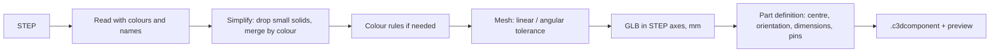

# Part converter — plan

Status: implemented in `tools/parts/` (TypeScript, OpenCascade in WebAssembly), 2026-11-16. First implemented in
Python with CadQuery (`tools/c3dparts/`), removed once the port gave the same outputs (PLAN.md, D19). Part of our package (PLAN.md, D11), not of Circuit Studio. Turns a STEP model into a
Circuit Studio part (`.c3dcomponent`) in one deterministic pass. Prototype: `spike/prepare_parts.py`,
`spike/simplify_steps.py`, `spike/inspect_step.py`.

## Commands

```bash
<pkg> part inspect model.step [--json]                         # what the skill needs to find contacts
<pkg> part convert part.yaml [--out part.c3dcomponent] [--preview part.png]   # the spec names its STEP
```

- `inspect` lists sub-assemblies and their names, colours present in the file, solids with bounding boxes and
  volumes, and candidate contact features (vertical or horizontal cylinders, thin pins) with their positions.
- `convert` never guesses: everything it needs is in the spec. Measuring is the `wiring-parts` skill's job,
  helped by `inspect`, with the user's confirmation.

## Part spec (`part.yaml`)

Written by the `wiring-parts` skill with the user; kept in the user's project next to the STEP.

```yaml
id: mrd076a-esp32-s3
name: MRD076A terminal adapter + ESP32-S3-DevKitC-1
step: design/references/mrd076a/MDR076A+ESP32-S3.STEP
orientation: [0, 0, 0]            # Euler XYZ, degrees, applied after centring
mesh: { linear: 0.25, angular: 0.7 }
simplify:
  minVolume: 1.0                  # mm³; drop smaller solids (0 keeps everything)
  mergeByColour: true             # only for parts without face-level colours
colours:                          # only when the STEP has no real colours
  palette: { pcb: "#2a2b28", terminal: "#2f9e4f", steel: "#a4a4aa", plastic: "#141414", gold: "#e4bb5c" }
  rules:                          # first match wins: sub-assembly name pattern + size test
    - { match: "Screw Terminal", largestOver: 6, colour: terminal }
    - { match: "Screw Terminal", colour: steel }
    - { match: "MDR076A", largestOver: 50, colour: pcb }
  default: plastic
pins:                             # positions in STEP coordinates (mm)
  - { id: J1-1, label: 3V3, aliases: [], at: [-29.17, 79.10, 4.0], exit: [-1, 0, 0] }
  - generate:                     # rows, for headers and terminal blocks
      ids: "J1-{n}"
      count: 22
      start: [-29.17, 79.10, 4.0]
      step: [0, -3.5, 0]
      exit: [-1, 0, 0]
      labels: [3V3, 3V3, RST, GPIO4, GPIO5, GPIO6, GPIO7, ...]
```

## Pipeline



- GLB keeps STEP axes in millimetres; the part definition carries `modelCenter` (bounding-box centre),
  `modelOrientation` and calibrated `dimensions` (Circuit Studio checks them within 0.15 mm), all measured on the
  written GLB as Circuit Studio measures it: the exact geometry's boxes are larger than the mesh on curved faces
  (up to 0.23 mm on the Claudemètre's threads and lugs, enough for Circuit Studio to reject the part).
- `geometry.modelAssetId` is the part's id: Circuit Studio loads a custom part's model through it (found when the
  first converted parts were imported, 2026-11-16).
- Pins are converted to the centred, rotated part frame, with `exitDirection` rotated the same way.
- Output follows upstream `LibraryPartSchema` (`{ format: "c3d-component", version: 1, part }`, model as base64).
- Preview: a PNG of the part with its pins and labels, for the user to check before use.

## STEP engine

Decision (PLAN.md, D16, superseding D12): **Node with OpenCascade compiled to WebAssembly**, `opencascade.js`
2.0.0-beta.b5ff984 (pinned). The Python + CadQuery implementation in `tools/c3dparts/` (first, proven) stayed as the
reference: the Node converter is tested against its outputs on the same STEP files.

Trial (2026-11-16, Node 22, WSL), reading with colours and names, scanning faces for cylinders, meshing and writing a
GLB with OCCT's own glTF writer:

| | Python (CadQuery 2.8, OCCT 7.9) | Node (opencascade.js 2.0 beta, WASM) |
|---|---|---|
| Fuse holder (7 solids, 641 faces) | — | 12.8 s, of which 5 s to load the module; 0.77 GB peak |
| MRD076A + ESP32-S3 (888 solids, 16 891 faces, 24 MB STEP) | inspect 62 s / 0.63 GB; convert 46 s / 1.1 GB | read + mesh + GLB 61 s / 1.7 GB |
| Same solids, faces and assembly names | reference | yes (34 names, non-ASCII ones too) |
| Install size | 1.8 GB Python environment | 64 MB npm package (50 MB WASM) |

Port done the same day in [tools/parts/](../tools/parts/) (`node tools/cli.ts part inspect|convert`, tests with
`npm test`). On the fixture both commands give the Python outputs exactly (reference JSON in
`tools/parts/test/fixtures/`). On the MRD076A:

| | Python | Node |
|---|---|---|
| `part inspect` | 60 s, 0.63 GB | 137 s, 0.79 GB; same facts (solids, faces, colours, 13 contact rows, names) |
| `part convert` (with preview) | 35 s, 1.1 GB | 69 s, 1.3 GB; same 44 pins, dimensions and centre; GLB 8.6 MB instead of 14 MB |

Where the time goes in WebAssembly: reading the STEP (41 s) and exact bounding boxes, slow on some faces (0.7 s
per terminal-block body). Each solid's box is computed once and group boxes are unions; `convert` meshes before
measuring, as the Python version did, so its boxes come from the triangulation (fast, same values).

API notes for the port: overloads carry `_1`, `_2` suffixes; `TDF_Label.FindAttribute_1` needs a
`Handle_TDF_Attribute` (embind returns the derived `TDataStd_Name`); extended strings are read through
`new TCollection_AsciiString_13(ext, 0).ToCString()` (UTF-8); `Quantity_Color.Red()` is linear RGB, convert to
sRGB; solid colours are often set on sub-shape labels (`XCAFDoc_ShapeTool.GetSubShapes`), not only on the part.

Packages considered: `opencascade.js` 1.1.1 (2021, older OCCT); `replicad-opencascadejs` 1.2.1 (maintained, 23 MB,
but no `STEPCAFControl_Reader` and no `RWGltf_CafWriter`: no colours or names from STEP, no GLB). If the pinned beta
ever blocks us, a custom `opencascade.js` build (our own fork, `circuitstudio-opencascade`) is the way out.

## Limits found in the spike

- Merging by colour loses face-level colours (dials, digits): `mergeByColour` only for parts without them.
- STEP colours can be absent or uniform (one SolidWorks default colour on 626 solids): colour rules required.
- Large STEPs need several GB of RAM; convert one part per process.
- Mesh weight drives render time: simplified parts rendered 1.8× faster, still slower than real time.

## Tests

- Golden test on a small public STEP: dimensions, pin positions, colour count, GLB validity.
- Round trip: the `.c3dcomponent` imports in Circuit Studio and renders with pins at the expected places.
