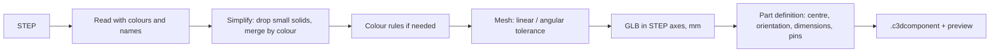

# Part converter — plan

Status: plan, 2026-11-16; first implementation in `tools/c3dparts/` (Python + CadQuery: `python -m c3dparts
inspect|convert`, tests in `tools/c3dparts/tests/`). Part of our package (PLAN.md, D11), not of Circuit Studio. Turns a STEP model into a
Circuit Studio part (`.c3dcomponent`) in one deterministic pass. Prototype: `spike/prepare_parts.py`,
`spike/simplify_steps.py`, `spike/inspect_step.py`.

## Commands

```bash
<pkg> part inspect model.step [--json]                         # what the skill needs to find contacts
<pkg> part convert part.yaml [--out part.c3dcomponent] [--preview part.png]   # the spec names its STEP
```

- `inspect` lists sub-assemblies and their names, colours present in the file, solids with bounding boxes and
  volumes, and candidate contact features (vertical or horizontal cylinders, thin pins) with their positions.
- `convert` never guesses: everything it needs is in the spec. Measuring is the `wiring-parts` skill's job,
  helped by `inspect`, with the user's confirmation.

## Part spec (`part.yaml`)

Written by the `wiring-parts` skill with the user; kept in the user's project next to the STEP.

```yaml
id: mrd076a-esp32-s3
name: MRD076A terminal adapter + ESP32-S3-DevKitC-1
step: design/references/mrd076a/MDR076A+ESP32-S3.STEP
orientation: [0, 0, 0]            # Euler XYZ, degrees, applied after centring
mesh: { linear: 0.25, angular: 0.7 }
simplify:
  minVolume: 1.0                  # mm³; drop smaller solids (0 keeps everything)
  mergeByColour: true             # only for parts without face-level colours
colours:                          # only when the STEP has no real colours
  palette: { pcb: "#2a2b28", terminal: "#2f9e4f", steel: "#a4a4aa", plastic: "#141414", gold: "#e4bb5c" }
  rules:                          # first match wins: sub-assembly name pattern + size test
    - { match: "Screw Terminal", largestOver: 6, colour: terminal }
    - { match: "Screw Terminal", colour: steel }
    - { match: "MDR076A", largestOver: 50, colour: pcb }
  default: plastic
pins:                             # positions in STEP coordinates (mm)
  - { id: J1-1, label: 3V3, aliases: [], at: [-29.17, 79.10, 4.0], exit: [-1, 0, 0] }
  - generate:                     # rows, for headers and terminal blocks
      ids: "J1-{n}"
      count: 22
      start: [-29.17, 79.10, 4.0]
      step: [0, -3.5, 0]
      exit: [-1, 0, 0]
      labels: [3V3, 3V3, RST, GPIO4, GPIO5, GPIO6, GPIO7, ...]
```

## Pipeline



- GLB keeps STEP axes in millimetres; the part definition carries `modelCenter` (bounding-box centre),
  `modelOrientation` and calibrated `dimensions` (Circuit Studio checks them within 0.15 mm).
- Pins are converted to the centred, rotated part frame, with `exitDirection` rotated the same way.
- Output follows upstream `LibraryPartSchema` (`{ format: "c3d-component", version: 1, part }`, model as base64).
- Preview: a PNG of the part with its pins and labels, for the user to check before use.

## STEP engine

Decision (PLAN.md, D12): **Python + CadQuery 2.8 first** (exact geometry, proven in the spike, same as upstream).
Evaluate a WASM engine (e.g. `occt-import-js`) when packaging for `npx`, since a 1.8 GB Python environment does
not fit a one-command install. The spec format stays the same whatever the engine.

## Limits found in the spike

- Merging by colour loses face-level colours (dials, digits): `mergeByColour` only for parts without them.
- STEP colours can be absent or uniform (one SolidWorks default colour on 626 solids): colour rules required.
- Large STEPs need several GB of RAM; convert one part per process.
- Mesh weight drives render time: simplified parts rendered 1.8× faster, still slower than real time.

## Tests

- Golden test on a small public STEP: dimensions, pin positions, colour count, GLB validity.
- Round trip: the `.c3dcomponent` imports in Circuit Studio and renders with pins at the expected places.
