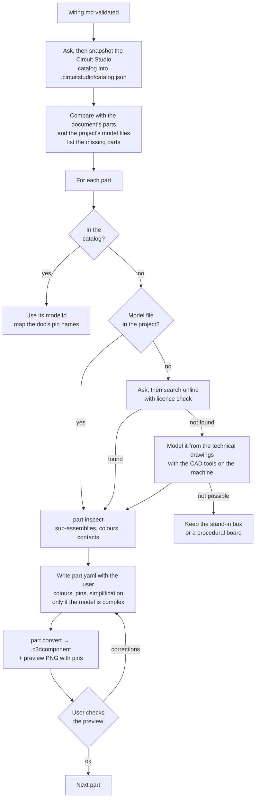

# wiring-parts — user guide

> Draft (2026-11-16): the skill is being designed. This page describes the intended behaviour and will be
> corrected as the skill is built.

`wiring-parts` is the second step, after `wiring-plan` has produced a validated wiring document. It gives every
part of that document a 3D model that Circuit Studio can show, with its pins at the right places.

## How it works

The skill never goes on the network without asking you first: before fetching the catalog, searching for a
model online or downloading anything, it says what it will fetch and from where, and you can say no.

At launch, after asking you, the skill takes a snapshot of the Circuit Studio catalog (built-in parts and their pins) into
`.circuitstudio/catalog.json`, compares it with the parts of the wiring document and the model files found in
your project, and lists what is missing. It then goes through the parts one by one. Prepared parts are kept in
`.circuitstudio/parts/<id>/`; you decide whether to commit them.

- **The skill measures, the command line converts.** `part inspect` reports facts about a model file
  (sub-assemblies, colours, candidate contacts); the skill writes the part's specification (`part.yaml`) with
  you; `part convert` turns it into a Circuit Studio part without guessing anything.
- **You check each part** on a preview image with its pins labelled, and correct it in plain words until it is
  right, as with the wiring document.
- **Pins get the names used in the wiring document**, as aliases when needed (`GPIO4` on terminal `J1-4`), so
  the document resolves cleanly into `wiring.json` afterwards.
- **Simplification only when needed**: if a model is really complex (many solids or a heavy mesh), the skill
  offers to simplify it (small hidden parts dropped, one body per colour), since lighter models render faster.
  Otherwise it uses the model as it is.
- **Licences**: a model found online is often not redistributable. The skill tells you, and you decide whether
  the prepared part is committed with your project.
