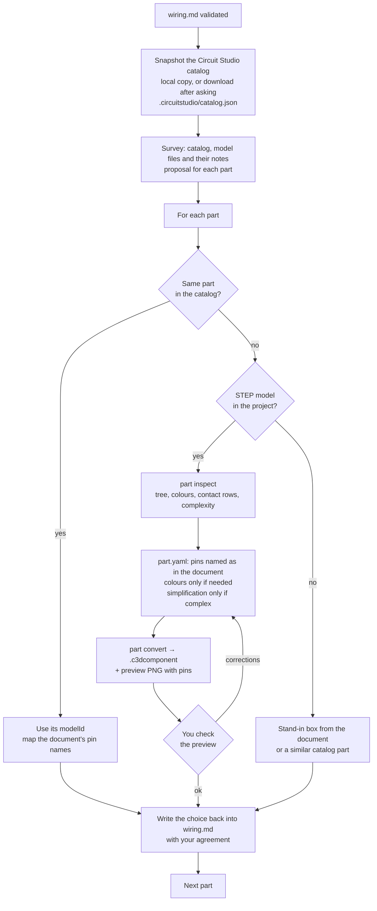

# wiring-parts — user guide

> First version (2026-11-16), tested on the Claudemètre: built-in Circuit Studio parts, STEP models already in
> your project, and stand-ins. Searching for a model online, modelling a part from its drawings and other model formats come
> later. This page follows the skill: [skills/wiring-parts/](../../../skills/wiring-parts/).

`wiring-parts` is the second step, after `wiring-plan` has produced a validated wiring document. It gives every
part of that document a 3D part that Circuit Studio can show, with its pins named as the document names them.

## Starting it

Until the kit's package exists, copy [skills/wiring-parts/](../../../skills/wiring-parts/) into your project's
`.claude/skills/` folder (or `~/.claude/skills/`), and keep a checkout of the kit: the skill runs its command line
with Node 22 (`node <kit>/tools/cli.ts part ...`). Then ask for it in your own words ("prepare the 3D parts of my
wiring") or type `/wiring-parts`.

## How it works

The skill never goes on the network without asking you first: before fetching the Circuit Studio catalog, it says
what it will fetch and from where, and you can say no.

- **Two stops.** The skill asks its questions at once, after surveying your parts: where to take the
  catalog from, how the panel parts stand (face towards the viewer, wires behind), whether to simplify the heavy
  models, and what the notes leave open (pin 1, polarity). It then prepares every part and shows them all in one
  review. What matters here is each part's pins and pose; where the parts sit in the scene comes with
  `wiring-project`.
- **The skill measures, the command line converts.** `part inspect` reports facts about a model file
  (sub-assemblies, colours, candidate contacts); the skill writes the part's specification (`part.yaml`) with
  you; `part convert` turns it into a Circuit Studio part without guessing anything.
- **A catalog part must be the same part.** A bare development board is not the board plugged onto a terminal
  adapter, since the wires land on the adapter's terminals. The skill tells you which near matches it rejected.
- **You check each prepared part** on a preview image with its pins labelled, and correct it in plain words
  ("pin 1 is at the other end") until you say "ok", as with the wiring document. You can also look at them in
  Circuit Studio itself: *Parts bin*, import button next to *Create component*, then the `.c3dcomponent`.
- **Pins get the names used in the wiring document**, as aliases when needed (`5V0` for `5V`), so
  [`wiring-project`](wiring-project.md) resolves the document cleanly into `wiring.json` afterwards. Pin positions or numbering that do not come from your
  project are marked as assumptions.
- **Simplification only when needed**: if `part inspect` finds a model really complex (many solids or faces),
  the skill offers to simplify it (small hidden solids dropped, one body per colour), since lighter parts render
  faster. Otherwise it uses the model as it is.
- **Stand-ins**: a part without a catalog match or a STEP model stays a plain box with its pins, as the document
  describes it (`stand-in W x H x T`); the project builder draws it. No file is written for it.
- **The document stays the source of truth**: the skill writes each decision back into `wiring.md` (the *Part*
  column, a stand-in's pins, a note) only after showing you the change.

## What it writes

| Path | Content |
|---|---|
| `.circuitstudio/catalog.json` | Snapshot of the Circuit Studio catalog (built-in parts and their pins) |
| `.circuitstudio/parts/<id>/part.yaml` | The part's specification: model, pins, colours, simplification |
| `.circuitstudio/parts/<id>/<id>.c3dcomponent` | The Circuit Studio part, with its model embedded |
| `.circuitstudio/parts/<id>/<id>.png` | The preview you checked |

**Licences**: a prepared part embeds its model. A model downloaded from a third party (GrabCAD, a vendor site)
is often not redistributable, and **you are responsible for the models you use and publish**: the kit never
refuses one and never decides for you. The skill tells you which parts come from such models, checks whether git
would commit `.circuitstudio/`, and you decide whether `.circuitstudio/parts/` is committed with your project; it
offers to add it to `.gitignore` if not. Re-rendering the video in CI needs the parts committed.
