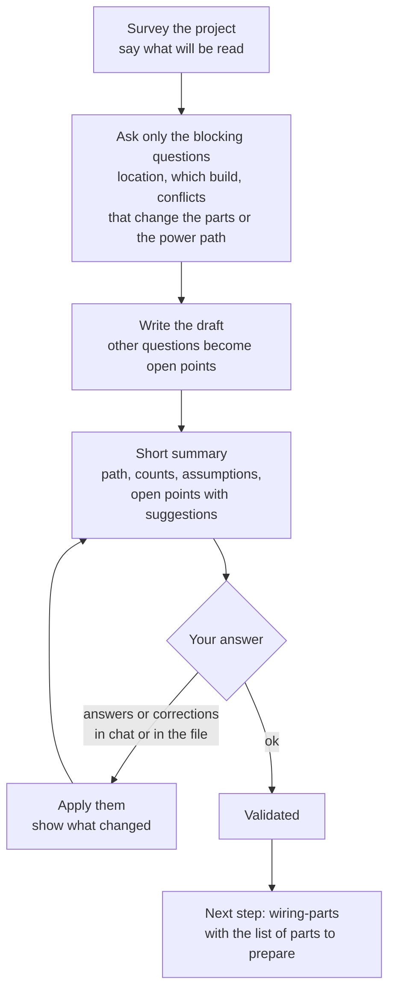

# wiring-plan — user guide

> First version (2026-11-16): the skill works and has been tested, and is still being refined. This page
> follows it.

`wiring-plan` is the **first step** towards a wiring video. It writes your project's wiring document: a
Markdown file, readable as documentation, that lists the parts and every wire between them. The next steps of
the kit start from that document.

Nothing is needed before it: no 3D model, no Circuit Studio, no particular project layout. Use it when you
want a wiring document or a wiring video, or when the hardware changed and an existing wiring document must
follow.

## Starting it

Once the kit's package exists, `npx <name> init` will ask whether to install it for this project only or for
all your projects. Until then (planned), copy [skills/wiring-plan/](../../../skills/wiring-plan/)
into your project's `.claude/skills/` folder, or into `~/.claude/skills/` for all your projects. Then, in
Claude Code, open your project and ask for it in your own words ("write the wiring document of this project")
or type `/wiring-plan`. The skill talks to you in your language and writes the document in English unless you
ask otherwise.

## What it reads

The skill looks through your project, without building or running anything, and tells you in a few lines what
it found and what it will read:

| Kind | Examples |
|---|---|
| Firmware and configuration | ESPHome YAML, Arduino sketch, PlatformIO, MicroPython, Zephyr overlays, pin headers |
| Schematic | KiCad schematic, netlist, Fritzing or EasyEDA export, schematic image or PDF |
| Documentation | README, specification, bill of materials, assembly notes |
| An existing wiring page | Markdown, HTML, PDF, image, spreadsheet |
| 3D model folders | STEP, STL, GLB files, and the notes next to them (reference, pin names, mounting) |

Firmware comes first: it is the most reliable source for signal pins. When sources disagree, the newer one
wins and the skill says so. If your project already has a Markdown wiring document, the skill completes and
corrects it instead of starting over, and tells you about anything it changes in what you wrote.

**Nothing to read?** If the project has nothing that describes the parts or their pins, the skill interviews
you instead, part by part: what the part is, how it is powered, which pins are used and where each goes; then
the power path and the grounds. Rounds are short, and the draft comes as soon as the main connections are
known. It does not ask about 3D models: parts without one become plain boxes (stand-ins) for now.

## Where the document goes

The skill **always asks where to write the document**, with a proposal that fits your project (its
documentation folder, for example), and writes nothing before you answer. The only exception is an existing
Markdown wiring document: it works on that file.

## What you get

A Markdown file that follows the [template](../../../skills/wiring-plan/template.md):

- a short introduction: the device, its power, the **sources used**, and what a reader needs to follow the
  tables (mounting, terminal numbering, which of several GND terminals is used and why);
- **Parts**: one row per part, with its kind, the pins used, the 3D model file found in your project, and a
  note;
- **Connections**: one row per wire, with its colour, in the order the video will connect them (power path
  first, then each function with its own ground);
- **Source notes**: where the document departs from your project's files, and why;
- **Recommendations**: only the suggestions you chose to keep (see below);
- **Checks**: what the sources agree on, what you confirmed, and what remains to check on the real parts;
- **Open points**: questions not answered yet, each with a suggestion; this section disappears once all are
  settled.

Only the Parts and Connections tables are required; everything else is yours to edit freely. For a complete
example, see [examples/claudemetre/wiring.md](../../../examples/claudemetre/wiring.md), the wiring document of a
real ESP32 desk gauge.

## Review until you say "ok"

The document is not finished when it is written: you validate it.

- The skill shows a **short summary**, not the whole file: where the document is, how many parts and
  connections, the assumptions it made, and the open points with its suggestions.
- You answer the open points or correct anything, by a plain message or by editing the file yourself (the
  skill reads it again and keeps your changes). Or you say **"ok"** to accept its suggestions as they are.
- After each round it shows what changed and asks again. It stops only on an explicit "ok": silence or a new
  topic is never taken as validation. You may validate with open points left; they stay as unticked checks.

## It never guesses

- **Inconsistencies are reported**, never settled silently: a GPIO in the docs that differs from the firmware,
  a part in the spec missing from the schematic. The skill asks which source is right.
- **Assumptions are marked.** General knowledge that is not in your project (a board's standard pinout, a
  module's usual size) may be used, always marked as an assumption and listed under "To check on the real
  parts". The same goes for a choice you leave to the skill ("your call").
- **Proposals are labelled.** When your sources give no wire colours, or do not say which of several
  equivalent terminals is used, the skill proposes one and says it is a proposal.

## Possible design problems

While reading, the skill may notice something that looks like a design problem: a logic level that may not
drive a module, a missing flyback diode, a supply that may be too weak. It **never changes the wiring** for
it. In the summary it only says how many it noticed and on which parts, that these are suggestions, that it
may be wrong, and that you should check them on your own build. You get the details only if you ask. A
suggestion you decline stays out of the document; one you want to keep without building it goes under
"Recommendations".

## Network

The skill does not go on the network: it works from your project's files and your answers. Like every skill
of the kit, it would ask you first, saying what and from where, before any network access.

## How it was tested

Fresh agents, with no knowledge of the project, ran the skill on a copy of a real project (the
[Claudemètre](https://github.com/docteurzoidberg/claudemetre)): first from its sources only, then with the
owner's answers to the open points. Another run started from an empty project, where the skill had to
interview the user.

## What comes next

Once you have validated the document, the skill proposes the next step and lists the parts it has to handle.
The next steps are **not finished yet**:

1. [`wiring-parts`](wiring-parts.md) gives every part a 3D model that Circuit Studio can show (being
   designed).
2. The document is resolved into `wiring.json`, the file the command line renders from, without an LLM
   (planned; the format exists, see [schema/wiring.schema.json](../../../schema/wiring.schema.json) and
   [examples/claudemetre/wiring.json](../../../examples/claudemetre/wiring.json)).
3. `wiring-project` generates the Circuit Studio project and reviews it with you (planned).
4. `wiring-video` renders the video from that project (planned).
