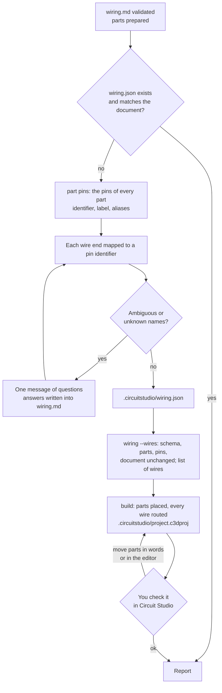

# wiring-project — user guide

> First version (2026-11-16), tested on the Claudemètre: resolving the wiring document into `wiring.json`,
> building the Circuit Studio project and reviewing it with you in Circuit Studio. This page follows the skill:
> [skills/wiring-project/](../../../skills/wiring-project/).

`wiring-project` is the third step, after [`wiring-plan`](wiring-plan.md) has produced a validated wiring
document and [`wiring-parts`](wiring-parts.md) has given each part a 3D model. It turns the document into
`.circuitstudio/wiring.json`, the file the command line builds and renders from without an LLM, then builds the
Circuit Studio project `.circuitstudio/project.c3dproj` and reviews it with you until you validate it.

## Starting it

Until the kit's package exists, copy [skills/wiring-project/](../../../skills/wiring-project/) into your
project's `.claude/skills/` folder (or `~/.claude/skills/`), and keep a checkout of the kit: the skill runs its
command line with Node 22 (`node <kit>/tools/cli.ts ...`). Building the project also needs a local copy of Circuit
Studio for now (its route planner comes from its sources): the one `wiring-parts` took the catalog from, or one
you name. Then ask for it in your own words ("turn my wiring into
the Circuit Studio project") or type `/wiring-project`.

## How it works



- **Your document keeps its own names.** You write `Board GPIO4` or `Display CLK`; the skill finds the pin they
  name (by its identifier, label, silkscreen or alias) and writes the pin's identifier into `wiring.json`.
- **It never guesses.** When a name fits several pins (two GND terminals) and nothing in the document tells them
  apart, or fits none, it asks you, citing the document line, with the likely candidates. Your answer goes into
  the document with your agreement (`Board 3V3` becomes `Board J1-1 (3V3)`), so the next run does not ask again.
- **The command line checks the result.** `wiring` checks the file against its schema, the parts and each pin,
  and that the document has not changed since. `wiring --wires` lists every wire as written and as resolved,
  which is what the skill's report asks you to look over:

  ```text
  wiring.md:47  blue    Board GPIO4 = Board J1-4 (GPIO4)  ->  Session gauge +
  wiring.md:51  green   Board GPIO6 = Board J1-6 (GPIO6)  ->  Display CLK = Display P1 (CLK)
  ```

- **When the document changes**, run the skill again: it sees that `wiring.json` no longer matches and resolves
  it again from the whole document.
- **The project is built for you.** `build` places the parts (from the document's *Layout* table if it has
  one, otherwise next to the pins their wires come from; panel meters keep facing you) and routes every wire with
  the planner Circuit Studio itself uses, so a wire it reports as routed is routed in Circuit Studio too:

  ```text
  .circuitstudio/project.c3dproj: 8 parts, 16 wires, 13.0 MB
    Board          automatic  x 0, y 0, 0°
    Session gauge  automatic  x 81.3, y -28.2, 0°
    ...
  routes: 16 wires, none blocked (1.5 s)
  ```

- **You check it in Circuit Studio.** When the kit reaches Circuit Studio (see
  [How the kit reaches Circuit Studio](../../../README.md#how-the-kit-reaches-circuit-studio)), the skill asks
  whether to open the project, opens it in your browser and reloads it after every build; what you move in the
  editor is read back by itself. While the kit drives the page, a red-bordered badge in its header says so
  ("Driven by Circuit Studio agent kit", its address, and a **Disconnect** button). Otherwise you open `.circuitstudio/project.c3dproj` there yourself (your local
  copy or the hosted site; the file stays in your browser), **Save**, and put the saved file in place of the
  project. Ask for changes in words ("put the display above the board"), or move things yourself in the editor.
  Every later build keeps
  what you moved, the wire shapes you changed and your camera, until you ask to give a part back to the automatic
  or *Layout* placement; what you never touched is placed again, so a new *Layout* hint in the document still
  applies. When a move blocks a wire, the skill tries a few others before asking you. Wiring changes (a pin, a
  colour) go into the document.
- **`wiring.json` is meant to be committed** with your project, since the command line renders from it. The
  project file embeds the parts' models, which may come from third-party files: publishing them is your call and
  responsibility. The skill tells you what git would commit and lets you decide.

## Tested on

A fresh agent, with no knowledge of the project, ran the skill on a copy of the
[Claudemètre](https://github.com/docteurzoidberg/claudemetre) as `wiring-parts` had left it (6 prepared parts,
2 stand-ins): 8 parts, 16 wires and 8 placements resolved without a question, the same wiring as
[examples/claudemetre/.circuitstudio/wiring.json](../../../examples/claudemetre/.circuitstudio/wiring.json).

A third fresh agent ran the review through the kit's connection to Circuit Studio (2026-11-16): the project
opened by itself in the owner's browser, the owner moved the step-down converter in the editor, the kit read it
back, rebuilt with every wire routed and reloaded the page, and the owner validated it. Its remarks shortened the
review messages and settled when to rebuild (not after an edit made in the editor).

A second fresh agent then built and reviewed the project on the same copy: every part placed from the document's
*Layout* table and every wire routed; asked in words to bring the step-down converter closer and turn the LED
strip, it found that both moves together blocked a wire, tried other positions, and settled with the user on a
layout where every wire routes. Its run found a defect since fixed (an edit was kept by one build only) and led to
the `--move`, `--dry-run` and `--reset` options.

## What comes next

[`wiring-video`](../../../README.md#skills) renders the video from the validated project (planned): when the page
is still connected, the skill offers it right after you validate, without reopening anything; until then,
Circuit Studio's own **Auto Video** renders it. Presentation texts come with the rendering, and so does a shorter
review: Circuit Studio served on your machine with the project opened, reloaded at every build and saving your
edits back by itself.
