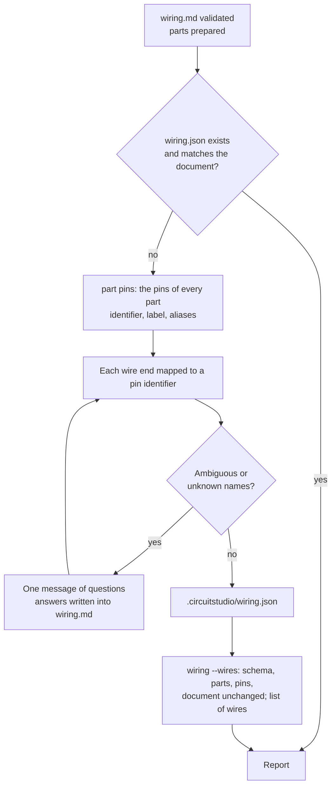

# wiring-project — user guide

> First part (2026-11-16): resolving the wiring document into `wiring.json`, tested on the Claudemètre. Building
> the Circuit Studio project comes next. This page follows the skill:
> [skills/wiring-project/](../../../skills/wiring-project/).

`wiring-project` is the third step, after [`wiring-plan`](wiring-plan.md) has produced a validated wiring
document and [`wiring-parts`](wiring-parts.md) has given each part a 3D model. It turns the document into
`.circuitstudio/wiring.json`, the file the command line builds and renders from without an LLM, then (in a later
version) builds the Circuit Studio project and reviews it with you.

## Starting it

Until the kit's package exists, copy [skills/wiring-project/](../../../skills/wiring-project/) into your
project's `.claude/skills/` folder (or `~/.claude/skills/`), and keep a checkout of the kit: the skill runs its
command line with Node 22 (`node <kit>/tools/cli.ts ...`). Then ask for it in your own words ("turn my wiring into
the Circuit Studio project") or type `/wiring-project`.

## How it works



- **Your document keeps its own names.** You write `Board GPIO4` or `Display CLK`; the skill finds the pin they
  name (by its identifier, label, silkscreen or alias) and writes the pin's identifier into `wiring.json`.
- **It never guesses.** When a name fits several pins (two GND terminals) and nothing in the document tells them
  apart, or fits none, it asks you, citing the document line, with the likely candidates. Your answer goes into
  the document with your agreement (`Board 3V3` becomes `Board J1-1 (3V3)`), so the next run does not ask again.
- **The command line checks the result.** `wiring` checks the file against its schema, the parts and each pin,
  and that the document has not changed since. `wiring --wires` lists every wire as written and as resolved,
  which is what the skill's report asks you to look over:

  ```text
  wiring.md:47  blue    Board GPIO4 = Board J1-4 (GPIO4)  ->  Session gauge +
  wiring.md:51  green   Board GPIO6 = Board J1-6 (GPIO6)  ->  Display CLK = Display P1 (CLK)
  ```

- **When the document changes**, run the skill again: it sees that `wiring.json` no longer matches and resolves
  it again from the whole document.
- **`wiring.json` is meant to be committed** with your project, since the command line renders from it. The
  skill tells you if git ignores it.

## Tested on

A fresh agent, with no knowledge of the project, ran the skill on a copy of the
[Claudemètre](https://github.com/docteurzoidberg/claudemetre) as `wiring-parts` had left it (6 prepared parts,
2 stand-ins): 8 parts, 16 wires and 8 placements resolved without a question, the same wiring as
[examples/claudemetre/wiring.json](../../../examples/claudemetre/wiring.json).

## What comes next

Building the Circuit Studio project from `wiring.json` (placement, wire routes, camera, presentation texts) and
reviewing it with you, then [`wiring-video`](../../../README.md#skills) renders the video.
