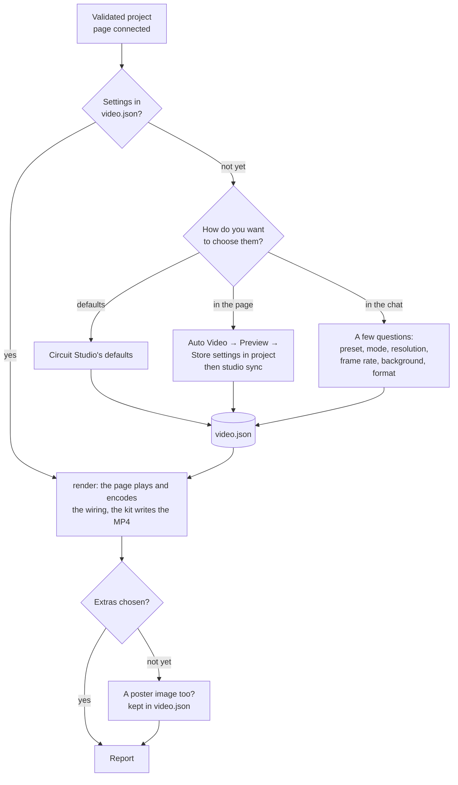

# wiring-video — user guide

> First version (2026-11-17). Its commands were checked on the Claudemètre and on Circuit Studio's own demo
> project, in the owner's browser; the skill itself is still to be tested by a fresh agent. This page follows the
> skill: [skills/wiring-video/](../../../skills/wiring-video/).

`wiring-video` is the last step, after [`wiring-project`](wiring-project.md) has built the Circuit Studio project
and you validated it. It has Circuit Studio render the wiring video in your browser, and keeps how you want the
video in `.circuitstudio/video.json`, so the next video comes out the same without a question.

## Starting it

At the end of `wiring-project`, say yes when it offers the video: the Circuit Studio page stays connected and
`wiring-video` starts from it. Later, ask for it in your own words ("make the video again") or type
`/wiring-video`. Like the other skills, copy [skills/wiring-video/](../../../skills/wiring-video/) into your
project's `.claude/skills/` folder until the kit's package exists.

It needs a Circuit Studio that has the kit's bridge on your machine (the kit's fork for now). Without one, the kit
can neither load the project nor render: you open `.circuitstudio/project.c3dproj` in Circuit Studio and click
**Auto Video** yourself.

## How it works



- **You choose the look once.** Circuit Studio's defaults (a tutorial that connects the wires one by one,
  1920 × 1080, 30 frames per second), your own choices in the page's **Auto Video** dialog (with its preview, and
  every setting: lights, floor, camera per shot), or a few questions in the chat. Circuit Studio checks every
  value: a value it does not accept is refused with the list of the allowed ones.
- **The same video next time.** The settings are kept in `.circuitstudio/video.json` and passed to Circuit
  Studio at every render, so the video does not change when Circuit Studio's defaults do, nor from one machine
  to another. To change them, use the page (then the skill reads them back) or ask in the chat.
- **You see it happen.** The page shows the render's progress and a **Cancel video** button. Leave the tab alone
  until it ends: reloading or closing it stops the render (run it again once the page is back).
- **Extras after the video.** Once, after the first video, the skill asks whether you also want a poster image
  (a still of the camera view, for a README); the answer is kept too.

```text
Settings: mode tutorial, 1920 × 1080, 30 fps, mp4, background dark-studio, HUD futuristic, labels minimal, wire 1.6 s + hold 0.7 s (from .circuitstudio/video.json).
Rendered .circuitstudio/media/ESP32-S3---USB-Circuit_Wiring_1080p30.mp4: 8.5 MB, 21.7 s, 652 frames, in 174 s.
```

## What to commit

`video.json` is small and worth committing: it is what makes the next render, yours or a CI job's, give the same
video. The videos in `.circuitstudio/media/` are large; the skill offers to keep them out of git if you publish
the video elsewhere. See the showcase's [`.circuitstudio/` folder](../../../examples/claudemetre/.circuitstudio/)
for what a project keeps.

## Measured

| Project | Settings | Video | Size | Render |
|---|---|---|---|---|
| Circuit Studio's demo (3 parts, 5 wires) | defaults | 21.7 s, 1080p, 30 fps | 8.5 MB | 174 s |
| Claudemètre, test build (8 parts, 16 wires) | defaults | 57.5 s, 1080p, 30 fps | 14.5 MB | 144 s and 156 s |
| Claudemètre, test build | orbit, 24 fps, gradient background | 9.2 s | 2.3 MB | 80 s |
| Claudemètre showcase (9 parts, 17 wires, detailed models) | defaults | 60.8 s, 1080p, 30 fps | 16.2 MB | 450 s |

The showcase's longer render is probably due to its detailed (not simplified) models; not measured further.
